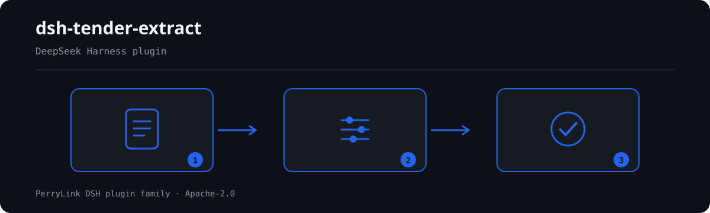

# dsh-tender-extract — 招标文件条款摘录核对

[English](README.md) · [简体中文](README-zh.md) · [Español](README-es.md) · [Português](README-pt.md) · [हिन्दी](README-hi.md)

[](https://dsh.market/)

`dsh-tender-extract` 读取一份条款摘录表——材料表头加每条摘录一行——套用版本化规则库，只就这张表本身出报告：每行是否给出出处（`sourceRef`）、原文栏（`rawText`）是否填写、提炼的要求（`requirement`）与原文是否有共同词、所填类别是否在本机构清单内、摘录序号（`seq`）是否重复、表头是否写明项目与来源文件、原文栏是否残留模板占位符。条款类别取值出厂为空，未配置时 `TE-004` 在 `skipped` 中说明自己未执行，而不是静默通过。

## Install

```sh
dsh plugin --profile <name> add dsh-tender-extract
dsh --profile <name> --dump-config | grep 'dsh-tender-extract'
```

## 实际输出长什么样



*工作流概览：调用 → 插件 → 结果。下面的示例使用实际命令面。*


本插件对自己 `TE-007` 测试夹具的**真实输出**，不是示意图。规则库不伪造引文，因此每条发现都会同时写明所引条款，以及该条款原文本次未取得。

## 它回答什么问题

### 示例

下表是示例集：第一行是详细走查，其余行是简短案例。

| 你会问 | 它怎么答 |
|---|---|
| 我表里有一条摘录的出处栏是空的，会报出来吗？ | 会。`TE-001` 要求每条摘录都填写 `sourceRef`，为空的行逐行报出。它只核对出处是否填写，从不判断出处指得对不对；它也**不声称能发现漏摘**——某条摘录是否摘全，只能与招标文件全文比对，而本插件看不到全文。 |
| 原文栏已经填了——插件会确认它与招标文件逐字一致吗？ | `TE-002` 只核对 `rawText` 栏是否填写。它不拿这段原文与招标文件比对，那需要持有人招标文件正本。 |
| 提炼的要求看着跟原文完全对不上，会被提示吗？ | `TE-003` 看 `requirement` 与 `rawText` 是否有共同词——重叠的汉字二字组与完整拉丁词——两栏一个共同词都没有时提示该行。提炼本身就会改写措辞，所以这条提示的含义是「这两栏看不出关系，值得人工复核」，**不断言提炼有误**。它也发现不了「提炼错误但用词相似」的情况；`minShared` 出厂为 2，是本机构口径、不是标准数值。 |
| 我们还没定条款类别怎么分，类别栏会怎样？ | 取值出厂为空，未填写前 `TE-004` 在 `skipped` 中说明自己未执行，而不是静默通过。配置之后它只核对所填值是否在册，不判断该条款应归入哪一类。 |
| 表里有两条摘录的序号一样。 | `TE-005` 比较两行的 `seq`（比较时忽略空白字符差异）并报出重复，因为序号重复会让人无法准确引用条款。序号编得合不合理，它不作判断。 |
| 有一条摘录的原文还是模板里的话。 | `TE-007` 报出 `rawText` 仍含出厂占位符列表所列词的行——`【`、`】`、`{{`、`}}`、`XXX`、`xxx`、`待填`、`待补充`、`TBD`、`todo`、`示例`——原文栏还留着这些词，说明摘录是照模板抄的，不是填进去的。该列表刻意不含 `（略）`，那是省略长条款的正常写法；它也只看得到列表内的词。 |

## 依据的标准

| 文件 | 文号 | 引用它的规则 |
|---|---|---|
| 《中华人民共和国招标投标法》 | 1999年8月30日通过，2017年12月27日修正（全国人大常委会《关于修改〈中华人民共和国招标投标法〉、〈中华人民共和国计量法〉的决定》），本法自2000年1月1日起施行 | TE-001, TE-002, TE-003, TE-004, TE-005, TE-006, TE-007 |

**边界（中文译文，以英文原文为准）：** 本插件核对一份**招标文件条款摘录表**，范围限于核对表可以据以要求的事项——每条摘录是否给出出处，条款原文是否记录，提炼出的要求与该原文是否具有某种字面关联，条款类别是否取自你配置的取值口径，序号是否唯一，以及是否残留占位符。

> ### ⚠️ 本插件能做哪些事、不能做哪些事（以英文原文为准）
>
> **它无法证明某条条款被漏掉了。** 判断一份摘录是否*完整*，需要与整份招标文件比对，而**本插件只能看到摘录表**。它从不作相反的声称，其规则 note 也写明这一点：`TE-001` 核对的是来源是否*记录在案*，从不是摘录是否详尽无遗。
>
> `TE-003` 是这里唯一的内容判断，而且它刻意做得很弱。它查找条款原文与提炼出的要求之间的**共同词项**，使用相互重叠的汉字二元组与完整的拉丁词，并且只在两者**毫无共同之处**时才报告。改写本来就会改变措辞，因此一条发现意味着「这两栏看起来不相关，值得人工看一眼」，而**从不**意味着「提炼错了」。它同样**抓不住「用词有重合但提炼是错的」情形**——这一局限已写在规则自己的 note 与该规则的 README 条目中。
>
> **规则库中的每一个 `excerpt` 都明文写着：条款原文本次未取得。** 该制度见于《中华人民共和国招标投标法》及其配套法规。核验环节无法取得逐字条款原文，因此规则库在 `excerpt` 字段本身写明这一缺口，并把每条规则保持在 `warn` 或 `info`。**待取得原文后，请把每个 `excerpt` 换成真实条款，并把 `kind` 提到 `direct`。** 条款类别取值清单出厂为**空**；在未配置任何取值时，`TE-004` 会把自己记入 `skipped`，而不是悄悄通过。

## Compatibility

| 项目 | 状态 |
|---|---|
| Harness | 对等版本范围 `>=0.1.2-rc.1 <0.2.0 \|\| >=0.2.0-0 <0.3.0` —— 已实测同时接受 `0.2.0-rc.2` 与 `0.2.1-rc.2`。**已声明 `engines.dsh`**：0.2.1 起由宿主单独裁决，范围为 `>=0.2.1-0 <0.3.0` |
| Node | `^22.19.0 || >=24.0.0` |
| 平台 | 全平台（纯 ESM；无原生代码、无联网、不调用模型） |
| 工具模式 | `native` / `ptc` 均可；批量校验整个目录时建议 `ptc`，schema 成本只付一次 |

## What it does

规则表、字段说明与行为细节见 [README.md](README.md#what-it-does)（英文主版本）。本插件只列出材料与所引条款之间的字面差异，并对无法执行的检查在 `skipped` 中逐项说明。

## Configuration

全部可调参数都在 `src/config.ts` 的 Schemastery schema 中，只改 `cordis.yml` 即可生效，无需改代码；逐条阈值在 `rules/` 下的规则库文件里。

| 键 | 类型 | 默认值 | 说明 |
|---|---|---|---|
| `rulesFile` | string | `rules/tender-extract.yaml` | 规则库文件路径，相对插件包根目录 |
| `disabledRules` | string[] | `[]` | 要停用的规则 id 列表；每条都会出现在 `skipped` 中 |
| `onlyRules` | string[] | `[]` | 只执行这些规则 id；留空表示执行全部规则 |
| `skipNotes` | string | `""` | 附加到每条 `skipped` 说明后的备注 |
| `timeoutMs` | number | `120000` | 工具协作式超时预算（毫秒） |

## Material format

支持 JSON 与 YAML。完整字段示例见 [README.md](README.md#material-format)（英文主版本）。字段在读取层是可选的，由检查引擎校验，因此部分导出的材料会产生"缺项"类差异，而不是让程序崩溃。

## Rule sources

规则数据与代码分离，每条规则都带文件名、文号、按原文自身编号体系的条款号、逐字摘录与来源地址。加载期强制：摘录必须是真实引文且不少于八个字符；依据仅为原则性条款（`kind: derived-from-principle`，严重级上限 `warn`）或本机构配置（`kind: institutional-configuration`，上限 `info`）的检查不得标为 `error`。夸大依据的规则库会在加载期失败，而不会产出一份看起来很有底气的报告。

核验中确认的边界与"刻意没有作出的结论"见 [README.md](README.md#rule-sources)（英文主版本）与随包的 `rules/evidence/` 目录。

## Troubleshooting

- **插件装上了但工具不出现**：确认 `main` 指向 `lib/index.mjs` 且 `pnpm run build` 已生成该文件；`main` 写错会让加载器静默跳过该条目。
- **`dsh plugin add` 报版本不兼容**：peer 范围覆盖 `0.1.x` 与 `0.2.x`；若运行时在其之外，可显式豁免：`dsh plugin --profile <name> allow-version <包名@版本> --dsh-version <runtime> --accept-risk`
- **某条规则没有执行**：查看 `skipped` 数组，其中写明了规则 id 与原因。
- **`check` 报 `manifest-peers` 失败**：静态检查器比对的是一份早于 0.2 世代的硬编码 peer 范围；安装期的 peer 校验以运行时为准。这是 `dsh-plugin-dev` 的已知上游问题。
- **时间看起来偏移**：全部计算都是对输入字符串做墙上时钟运算，不做时区换算。

## Development

```sh
pnpm install
pnpm run typecheck
pnpm test
pnpm run build
node ../scripts/sync-shared.mjs dsh-tender-extract
```

第 4 项把 `../_shared` 的共享件同步进 `src/shared/`；每次改动共享件后都要重跑。

## PerryLink DSH Plugin Family

本项目是 [PerryLink](https://github.com/PerryLink) 维护的 DeepSeek Harness 插件家族成员。完整名单默认折叠，避免每个 README 的首屏被长表淹没；点击展开可查看每一行及其状态。

<details>
<summary>展开全部插件</summary>

| 插件 | 状态 |
|---|---|
| **[dsh-aqua-input-check](https://github.com/PerryLink/dsh-aqua-input-check)** |  |
| **[dsh-archive-check](https://github.com/PerryLink/dsh-archive-check)** |  |
| **[dsh-auto-review](https://github.com/PerryLink/dsh-auto-review)** |  |
| **[dsh-autotier](https://github.com/PerryLink/dsh-autotier)** |  |
| **[dsh-bid-ca-precheck](https://github.com/PerryLink/dsh-bid-ca-precheck)** |  |
| **[dsh-bid-qual-check](https://github.com/PerryLink/dsh-bid-qual-check)** |  |
| **[dsh-cert-mcp](https://github.com/PerryLink/dsh-cert-mcp)** |  |
| **[dsh-checkpoint-rewind](https://github.com/PerryLink/dsh-checkpoint-rewind)** |  |
| **[dsh-click](https://github.com/PerryLink/dsh-click)** |  |
| **[dsh-composer-history](https://github.com/PerryLink/dsh-composer-history)** |  |
| **[dsh-contract-stance](https://github.com/PerryLink/dsh-contract-stance)** |  |
| **[dsh-customs-doc-check](https://github.com/PerryLink/dsh-customs-doc-check)** |  |
| **[dsh-data-quality](https://github.com/PerryLink/dsh-data-quality)** |  |
| **[dsh-demurrage-ledger](https://github.com/PerryLink/dsh-demurrage-ledger)** |  |
| **[dsh-doublecheck](https://github.com/PerryLink/dsh-doublecheck)** |  |
| **[dsh-drill-script-check](https://github.com/PerryLink/dsh-drill-script-check)** |  |
| **[dsh-eia-guide-check](https://github.com/PerryLink/dsh-eia-guide-check)** |  |
| **[dsh-emergency-plan](https://github.com/PerryLink/dsh-emergency-plan)** |  |
| **[dsh-essay-rubric-check](https://github.com/PerryLink/dsh-essay-rubric-check)** |  |
| **[dsh-evidence-check](https://github.com/PerryLink/dsh-evidence-check)** |  |
| **[dsh-export-ctl-check](https://github.com/PerryLink/dsh-export-ctl-check)** |  |
| **[dsh-fast](https://github.com/PerryLink/dsh-fast)** |  |
| **[dsh-fmea-table-check](https://github.com/PerryLink/dsh-fmea-table-check)** |  |
| **[dsh-forecast-penalty](https://github.com/PerryLink/dsh-forecast-penalty)** |  |
| **[dsh-fund-research](https://github.com/PerryLink/dsh-fund-research)** |  |
| **[dsh-github](https://github.com/PerryLink/dsh-github)** |  |
| **[dsh-gongwen-flow-check](https://github.com/PerryLink/dsh-gongwen-flow-check)** |  |
| **[dsh-gongwen-word-check](https://github.com/PerryLink/dsh-gongwen-word-check)** |  |
| **[dsh-guard-plan-qc](https://github.com/PerryLink/dsh-guard-plan-qc)** |  |
| **[dsh-hazchem-check](https://github.com/PerryLink/dsh-hazchem-check)** |  |
| **[dsh-hazplan-check](https://github.com/PerryLink/dsh-hazplan-check)** |  |
| **[dsh-hidden-risk-map](https://github.com/PerryLink/dsh-hidden-risk-map)** |  |
| **[dsh-hs-classify](https://github.com/PerryLink/dsh-hs-classify)** |  |
| **[dsh-icd-rule-check](https://github.com/PerryLink/dsh-icd-rule-check)** |  |
| **[dsh-industry-research](https://github.com/PerryLink/dsh-industry-research)** |  |
| **[dsh-lawcite-adapter](https://github.com/PerryLink/dsh-lawcite-adapter)** |  |
| **[dsh-laya](https://github.com/PerryLink/dsh-laya)** |  |
| **[dsh-lc-doc-check](https://github.com/PerryLink/dsh-lc-doc-check)** |  |
| **[dsh-learning-gap-check](https://github.com/PerryLink/dsh-learning-gap-check)** |  |
| **[dsh-library](https://github.com/PerryLink/dsh-library)** |  |
| **[dsh-local-ai](https://github.com/PerryLink/dsh-local-ai)** |  |
| **[dsh-lsp-actions](https://github.com/PerryLink/dsh-lsp-actions)** |  |
| **[dsh-mask](https://github.com/PerryLink/dsh-mask)** |  |
| **[dsh-mcp-panel](https://github.com/PerryLink/dsh-mcp-panel)** |  |
| **[dsh-medrec-qc](https://github.com/PerryLink/dsh-medrec-qc)** |  |
| **[dsh-memento](https://github.com/PerryLink/dsh-memento)** |  |
| **[dsh-nsfc-form-check](https://github.com/PerryLink/dsh-nsfc-form-check)** |  |
| **[dsh-nurse-record-check](https://github.com/PerryLink/dsh-nurse-record-check)** |  |
| **[dsh-observe](https://github.com/PerryLink/dsh-observe)** |  |
| **[dsh-origin-rvc-check](https://github.com/PerryLink/dsh-origin-rvc-check)** |  |
| **[dsh-ota-review-check](https://github.com/PerryLink/dsh-ota-review-check)** |  |
| **[dsh-output-styles](https://github.com/PerryLink/dsh-output-styles)** |  |
| **[dsh-paper-doc-adapter](https://github.com/PerryLink/dsh-paper-doc-adapter)** |  |
| **[dsh-permission-rules](https://github.com/PerryLink/dsh-permission-rules)** |  |
| **[dsh-permit-report-check](https://github.com/PerryLink/dsh-permit-report-check)** |  |
| **[dsh-pipeline-check](https://github.com/PerryLink/dsh-pipeline-check)** |  |
| **[dsh-pleading-draft](https://github.com/PerryLink/dsh-pleading-draft)** |  |
| **[dsh-plugin-doctor](https://github.com/PerryLink/dsh-plugin-doctor)** |  |
| **[dsh-plugin-guide](https://github.com/PerryLink/dsh-plugin-guide)** |  |
| **[dsh-plugin-kit](https://github.com/PerryLink/dsh-plugin-kit)** |  |
| **[dsh-plugin-upgrade](https://github.com/PerryLink/dsh-plugin-upgrade)** |  |
| **[dsh-policy-brief-draft](https://github.com/PerryLink/dsh-policy-brief-draft)** |  |
| **[dsh-power-loss-split](https://github.com/PerryLink/dsh-power-loss-split)** |  |
| **[dsh-power-ticket-check](https://github.com/PerryLink/dsh-power-ticket-check)** |  |
| **[dsh-ppap-check](https://github.com/PerryLink/dsh-ppap-check)** |  |
| **[dsh-protest-deadline](https://github.com/PerryLink/dsh-protest-deadline)** |  |
| **[dsh-railway-window](https://github.com/PerryLink/dsh-railway-window)** |  |
| **[dsh-repair-order-qc](https://github.com/PerryLink/dsh-repair-order-qc)** |  |
| **[dsh-research-report](https://github.com/PerryLink/dsh-research-report)** |  |
| **[dsh-review-reply-check](https://github.com/PerryLink/dsh-review-reply-check)** |  |
| **[dsh-rulefile-check](https://github.com/PerryLink/dsh-rulefile-check)** |  |
| **[dsh-safety-brief-check](https://github.com/PerryLink/dsh-safety-brief-check)** |  |
| **[dsh-score](https://github.com/PerryLink/dsh-score)** |  |
| **[dsh-session-sync](https://github.com/PerryLink/dsh-session-sync)** |  |
| **[dsh-site-log-check](https://github.com/PerryLink/dsh-site-log-check)** |  |
| **[dsh-skill-pack-security](https://github.com/PerryLink/dsh-skill-pack-security)** |  |
| **[dsh-soe-decision-check](https://github.com/PerryLink/dsh-soe-decision-check)** |  |
| **[dsh-soilwater-check](https://github.com/PerryLink/dsh-soilwater-check)** |  |
| **[dsh-sop-sync-check](https://github.com/PerryLink/dsh-sop-sync-check)** |  |
| **[dsh-spc-gbt-adapter](https://github.com/PerryLink/dsh-spc-gbt-adapter)** |  |
| **[dsh-talk](https://github.com/PerryLink/dsh-talk)** |  |
| **[dsh-tender-extract](https://github.com/PerryLink/dsh-tender-extract)** |  |
| **[dsh-tender-matrix](https://github.com/PerryLink/dsh-tender-matrix)** |  |
| **[dsh-test-drive](https://github.com/PerryLink/dsh-test-drive)** |  |
| **[dsh-ticktick](https://github.com/PerryLink/dsh-ticktick)** |  |
| **[dsh-translate](https://github.com/PerryLink/dsh-translate)** |  |
| **[dsh-warranty-calc](https://github.com/PerryLink/dsh-warranty-calc)** |  |
| **[dsh-budget](https://github.com/PerryLink/dsh-budget)** | 🧊 已冻结 — 见仓库 README |
| **[dsh-claude-move](https://github.com/PerryLink/dsh-claude-move)** | 🧊 已冻结 — 见仓库 README |
| **[dsh-defend](https://github.com/PerryLink/dsh-defend)** | 🧊 已冻结 — 见仓库 README |
| **[dsh-draw](https://github.com/PerryLink/dsh-draw)** | 🧊 已冻结 — 见仓库 README |
| **[dsh-reach](https://github.com/PerryLink/dsh-reach)** | 🧊 已冻结 — 见仓库 README |
| **[dsh-background-agents](https://github.com/PerryLink/dsh-background-agents)** | 🚫 已退役 — 见仓库 README |
| **[dsh-session-pin](https://github.com/PerryLink/dsh-session-pin)** | 🚫 已退役 — 见仓库 README |
| **[dsh-team-rooms](https://github.com/PerryLink/dsh-team-rooms)** | 🚫 已退役 — 见仓库 README |

</details>

## License

[Apache License 2.0](LICENSE) © 2026 dsh-tender-extract contributors.
