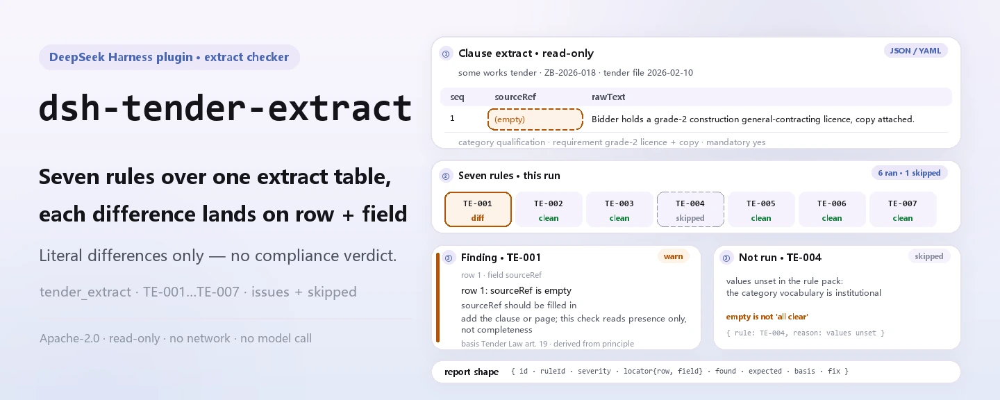
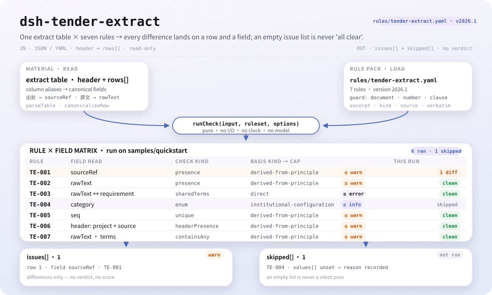
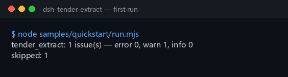

<div align="center">

<picture>
  <source media="(prefers-color-scheme: dark)" srcset="docs/assets/dsh-tender-extract-hero-en-dark.webp">
  
</picture>

# dsh-tender-extract

**Read a tender clause-extract table and get, row by row, what is off and where — differences only, no verdict.**

A DSH checker for tender agents and bidders: seven rules cover source, raw text, distilled requirement, category, sequence and template placeholders, and every finding names the row, the field and the fix.

[Install](#three-step-setup) · [Configuration](#configuration) · [FAQ](#faq) · [简体中文](README.md) · [English](README.en.md) · [Español](README.es.md) · [Português](README.pt.md) · [हिन्दी](README.hi.md)

[](LICENSE)
[](#compatibility)
[](https://www.npmjs.com/package/dsh-tender-extract)
[](https://github.com/PerryLink/dsh-tender-extract/actions/workflows/ci.yml)
[](#compatibility)

[](https://github.com/PerryLink/dsh-tender-extract/stargazers)
[](https://www.npmjs.com/package/dsh-tender-extract)
[](https://dshfind.com/plugins/PerryLink/dsh-tender-extract?ref=badge)
[](https://securityscorecards.dev/viewer/?uri=github.com/PerryLink/dsh-tender-extract)
[](https://dsh.market/)
[](https://gitee.com/perrylink/dsh-tender-extract)

```sh
dsh plugin --profile <name> add dsh-tender-extract
```

</div>

<sub>Community plugin, not affiliated with DeepSeek. Canonical repository: <https://github.com/PerryLink/dsh-tender-extract> (Gitee is a mirror).</sub>

## What it is

`dsh-tender-extract` reads one clause-extract table — the package header plus one row per extract — applies a versioned rule pack and returns a report on that table alone: that every row gives its source (`sourceRef`), that the raw clause text column (`rawText`) is filled in, that the distilled requirement (`requirement`) shares at least some terms with that raw text, that a recorded category is on your institution's list, that no extract number (`seq`) is repeated, that the header names the project and the source document, and that no template placeholder survives in the raw text. The clause-category vocabulary ships empty, and with nothing configured `TE-004` reports itself in `skipped` instead of passing quietly.

Who it is for: tender agents and bidders; no command line required. What you give it: the source material the check works on (a table, register or document); the original is never modified, and Excel can be converted to JSON/YAML first — in chat if the platform supports it. What it does not do: no compliance verdict, no liability finding, no replacement for the reviewer; differences only.

<picture>
  <source media="(prefers-color-scheme: dark)" srcset="docs/assets/dsh-tender-extract-flow-v5-dark.svg">
  
</picture>

## Three-step setup

1. **Install** (pick one channel):

   ```sh
   # npm channel (published releases)
   dsh plugin --profile web add dsh-tender-extract
   # git channel (latest main)
   dsh plugin --profile web add github:PerryLink/dsh-tender-extract
   # tarball channel: pnpm pack in this repo, then
   dsh plugin --profile web add ./dsh-tender-extract-<version>.tgz
   ```

   npm packages ship the built `lib/`; installing from git or a tarball requires `lib/index.mjs` (the `main` target) to be produced by `pnpm run build`.

2. **Minimal config** (the defaults work; swap the rule pack or disable rules as needed):

   ```yaml
   - insert:
       - id: dsh-tender-extract
         name: dsh-tender-extract
         config:
           rulesFile: rules/tender-extract.yaml
   ```

3. **Verify it mounts**:

   ```sh
   dsh --profile web --dump-config | grep 'dsh-tender-extract'
   node samples/quickstart/run.mjs --check
   ```

   ```
   tender_extract: 1 issue(s) — error 0, warn 1, info 0
   skipped: 1
   ```

   Samples live in `samples/quickstart/input/` and the expected output in `samples/quickstart/expected/result.json`; a source checkout needs `pnpm run build` first. Real first-run capture:

   

**Uninstall**: `dsh plugin --profile web remove dsh-tender-extract` (or remove the row from the profile patch).

> Search "Tender Compliance Suite" in WorkBuddy / Coze (this check is one part of it; availability as listed); the command-line entry is the `dsh plugin` command above.

## Core capabilities

`dsh-tender-extract` checks the **extract table's own completeness and internal consistency** — it never judges whether an extract is exhaustive and never issues a compliance verdict. All seven rules come from a replaceable rule pack:

| Rule | What it checks | Severity | Basis kind |
|---|---|---|---|
| `TE-001` | every extract gives its source (`sourceRef`) | `warn` | `derived-from-principle` |
| `TE-002` | every extract records the raw text (`rawText`) | `warn` | `derived-from-principle` |
| `TE-003` | the requirement shares terms with the raw text | `warn` | `direct` |
| `TE-004` | the category comes from your vocabulary (off by default) | `info` | `institutional-configuration` |
| `TE-005` | extract numbers are unique | `warn` | `derived-from-principle` |
| `TE-006` | the table names its project and source document | `warn` | `derived-from-principle` |
| `TE-007` | the raw text holds no unreplaced template placeholder | `warn` | `derived-from-principle` |

- **A locatable report.** Every finding is `{ id, ruleId, severity, locator, found, expected, fix }`: `locator` names the row and the field, and `fix` is one actionable sentence. The report lists differences only — no ranking, no score.
- **An empty result is not a clean bill.** Every check that could not run lands in `skipped` with its reason; that is exactly how `TE-004` reports itself while the category vocabulary is empty, instead of passing quietly.
- **The rule pack is data.** All seven rules live in `rules/tender-extract.yaml`; replacing the file switches the rule set. Loading validates that `document` / `number` / `clause` / `excerpt` / `kind` / `source` are present and that `excerpt` is a verbatim quotation.
- **Read-only, deterministic, model-free.** No network, no model call, no file writes; all arithmetic is wall-clock arithmetic over the input strings, with no timezone conversion.

### What the report looks like

Below is the real output against the `TE-003` fixture, not an illustration.

**Tool** `tender_extract`

**Input**

```json
{"rows":[{"原文":"甲乙丙丁戊己庚辛","要求":"一二三四五六七八"}]}
```

**Output**

```json
{
  "id": "dsh-tender-extract.TE-003.de09b5a6",
  "ruleId": "TE-003",
  "severity": "warn",
  "locator": {
    "row": 1,
    "field": "requirement"
  },
  "found": "第 1 行「requirement」与「rawText」没有共同词（共同词 0 个，配置下限 2 个）",
  "expected": "「requirement」应与「rawText」在字面上相关",
  "fix": "本条只提示两栏看不出关系、值得人工复核，不断言提炼有误；同义改写会拉低共同词数，可调整 minShared"
}
```

*Observed from `dsh-tender-extract/tests/fixtures/TE-003/TE-003-unsafe.json`*

## Configuration

All tunables are Schemastery `Config` fields in `src/config.ts`, changeable from `cordis.yml` without touching code; per-rule thresholds live in the rule pack under `rules/`. An id-targeted override replaces the whole row — restate every key you need.

| Key | Type | Default | Description |
|---|---|---|---|
| `rulesFile` | string | `rules/tender-extract.yaml` | Rule-pack path, relative to the package root |
| `disabledRules` | string[] | `[]` | Rule ids to stop running; each appears in `skipped` |
| `onlyRules` | string[] | `[]` | Run only these rule ids; empty runs every rule |
| `skipNotes` | string | `""` | Note appended to every `skipped` reason |
| `timeoutMs` | number | `120000` | Cooperative tool timeout budget |

Rule-level parameters (inside the rule pack's `params`):

- `TE-003` `leftField` / `rightField` / `minShared` — the two columns and the shared-term floor, `2` by default. Set it to `1` to be more permissive; the floor is **a local convention, not a standard figure**.
- `TE-004` `values` — your clause categories, e.g. `[qualification, technical-specification, commercial-terms, evaluation-method, contract-terms]`; empty means no check.
- `TE-007` `terms` — the placeholders to look for. The omitted-passage marker is deliberately **absent**: it is a normal way to abridge a long clause, so it is not treated as a placeholder. If your template really uses it to stand in for a whole clause, add it to `terms` yourself.

Example override in your profile patch:

```yaml
- insert:
    - id: dsh-tender-extract
      name: dsh-tender-extract
      config:
        disabledRules: [TE-007]
        skipNotes: Template placeholders are out of scope for this project
```

## Material format

The tool accepts JSON or YAML:

```yaml
project: 某某工程施工招标
tenderNo: ZB-2026-018
source: 招标文件 2026-02-10 版
rows:
  - { 序号: '1', 出处: 第三章 第 3.2 条,
      原文: 投标人应具有建筑工程施工总承包二级及以上资质，并附资质证书复印件。,
      类别: 资格条件, 要求: 需具备建筑工程施工总承包二级及以上资质并提供证书复印件,
      是否实质性: 是, 响应: 需响应, 责任部门: 经营部 }
```

Column names are matched case-insensitively and ignoring spaces, underscores and hyphens; the table's own column names are kept, so a finding names the column it read.

## FAQ

<details>
<summary>One clause is missing from my table. Will the plugin catch that?</summary>

No. Deciding whether an extract is *complete* requires comparing against the whole tender document, and **this plugin only ever sees the extract table**. `TE-001` checks that a source is *recorded*, never that the extract is exhaustive, and it does not claim otherwise.

</details>

<details>
<summary>The raw text column is filled in — does the plugin confirm it matches the tender document word for word?</summary>

No. `TE-002` only checks that the `rawText` column is filled; it does not compare that text against the tender document, which needs the document itself in hand.

</details>

<details>
<summary>The distilled requirement looks as if it came from somewhere else entirely. Will that be flagged?</summary>

`TE-003` looks for shared terms between `requirement` and `rawText` — overlapping Han bigrams and whole Latin words — and reports the row when the two share nothing. Paraphrase legitimately changes wording, so a finding means the two columns look unrelated and are worth a human look, never that the distillation is wrong. It also cannot catch a distillation that is wrong while sharing vocabulary, and the `minShared` floor of `2` is a local convention, not a standard figure.

</details>

<details>
<summary>We have not decided how to classify our clauses yet. What happens to the category column?</summary>

Its values ship empty, so `TE-004` reports itself in `skipped` rather than passing quietly until you fill them in. Once configured it checks only that the recorded value is on your list; it does not decide which category a clause belongs to.

</details>

<details>
<summary>Where is the data stored? Does it call the network or a model?</summary>

Neither. The plugin reads the material you point it at, with `writes` empty and `network: false`, and never calls a model; the report is built in memory and returned — no upload, no external service, and the original file is not modified.

</details>

## Security boundaries

- **The extract table is the whole input.** Deciding whether an extract is complete requires the full tender document, and this plugin only sees the extract table; it cannot prove a clause was missed, it only exposes places where the register does not hold together.
- **The one content judgement is deliberately weak.** `TE-003` looks only for shared terms between the raw text and the distilled requirement, and reports only when the two share nothing; a finding means "these two columns look unrelated, worth a human look", never "the distillation is wrong".
- **Citation discipline.** Every `excerpt` in the rule pack is a verbatim quotation (replaced rule by rule on 2026-10-07; the verification record is in `rules/evidence/`), and the evidence strength is stated in `kind`: `derived-from-principle` is capped at `warn`, `institutional-configuration` at `info`, and only `TE-003` is `direct`. A pack that overstates its basis fails at load rather than producing an impressive-looking report.
- **An empty list reports itself.** The clause-category vocabulary ships empty; with nothing configured, `TE-004` lands in `skipped` rather than passing quietly.
- **No adjudicating wording.** The report never pronounces on compliance, liability or correctness; a wording guard blocks such statements, and the report always carries the disclaimer.
- **Read-only and offline.** It reads the material the user names, with `writes` empty and `network: false`; no model call and no material content sent to any service.
- **The citation guard has a hard limit.** The load-time guard can demand that an `excerpt` be at least eight characters long, but it cannot tell a quotation from a description; the pack therefore also leans on the header, each rule's `note`, and a test asserting that every `excerpt` states its verification status truthfully.

### Standards it follows

| Document | Number | Cited by rules |
|---|---|---|
| Tender and Bidding Law of the People's Republic of China | Adopted 1999-08-30; amended 2017-12-27 by the NPC Standing Committee decision amending the Tender and Bidding Law and the Metrology Law; effective 2000-01-01 | TE-001, TE-002, TE-003, TE-004, TE-005, TE-006, TE-007 |

**Boundary:** this plugin checks a clause-extract table for what a checklist can be held to — that every extract gives its source, that the raw clause text is recorded, that the distilled requirement bears some lexical relation to that text, that the category comes from your configured vocabulary, that numbers are unique, and that no placeholder survives.

Verbatim Chinese title and citation number carried by the rule pack:

```text
《中华人民共和国招标投标法》
1999年8月30日通过，2017年12月27日修正（全国人大常委会《关于修改〈中华人民共和国招标投标法〉、〈中华人民共和国计量法〉的决定》），本法自2000年1月1日起施行
```

## Known limitations

- **It cannot prove a clause was missed.** Completeness can only be judged against the whole tender document, which this plugin never sees; `TE-001` only checks that a source is recorded.
- **`TE-002` does not compare the text.** It only checks that the raw-text column is filled; confirming a word-for-word match needs the tender document in hand.
- **Three limits of `TE-003`.** Paraphrase lowers the shared-term count and can trigger a finding; a wrong distillation that keeps the vocabulary cannot be caught; the `minShared` floor of `2` is a local convention, not a standard figure.
- **`TE-005` only finds repeats.** It compares `seq` values ignoring whitespace differences; it does not judge whether the numbering is otherwise sensible.
- **`TE-007` only sees its term list.** It matches the factory list and cannot see placeholder styles outside it; the omitted-passage marker is deliberately absent because it is a normal way to abridge a long clause.
- **Six rules are not `direct`.** `TE-001` / `TE-002` / `TE-005` / `TE-006` / `TE-007` rest on principle clauses and `TE-004` on local configuration, so severity is capped at `warn` / `info`; only `TE-003` is `direct`.
- **A known upstream issue in the static checker.** `check` may report `manifest-peers` as failed because it compares against a hard-coded peer range that predates the 0.2 line; the runtime enforces peer compatibility at install time.

The `TE-007` factory term list, verbatim from `rules/tender-extract.yaml`:

```text
【  】  {{  }}  XXX  xxx  待填  待补充  TBD  todo  示例
Deliberately absent: （略） — "……（略）" is a normal way to abridge a long clause.
```

## Compatibility

| Surface | Status |
|---|---|
| Harness | Peer range `>=0.1.2-rc.1 <0.2.0 \|\| >=0.2.0-0 <0.3.0` — verified to accept both `0.2.0-rc.2` and `0.2.1-rc.2`. **`engines.dsh` is declared as `>=0.2.1-0 <0.3.0`** and the host enforces it since 0.2.1 |
| Node | `^22.19.0 \|\| >=24.0.0` |
| Platforms | All (plain ESM; no native code, no network, no model call) |
| Tool mode | Works in `native` and `ptc`; for a whole directory use `ptc` |

## Ecosystem & quality

- [Gitee mirror](https://gitee.com/perrylink/dsh-tender-extract) (sync mirror; GitHub is canonical)
- [dshfind plugin page](https://dshfind.com/plugins/PerryLink/dsh-tender-extract) (installs and ranking)
- [OpenSSF Scorecard report](https://securityscorecards.dev/viewer/?uri=github.com/PerryLink/dsh-tender-extract) (driven by [.github/workflows/scorecard.yml](.github/workflows/scorecard.yml))
- [DSH Market](https://dsh.market/) (listed)
- [Choose a checker by material](https://perrylink.github.io/zh/checkers/choose/) (PerryLink family index)

## Troubleshooting

- **The plugin installs but the tool never appears.** Check that `main` resolves to `lib/index.mjs` and that `pnpm run build` produced it; a wrong `main` makes the loader skip the entry silently.
- **`dsh plugin add` refuses the package as incompatible.** The peer range covers `0.1.x` and `0.2.x`; if your runtime sits outside it, grant an explicit exemption: `dsh plugin --profile <name> allow-version dsh-tender-extract@0.2.12 --dsh-version <runtime> --accept-risk`.
- **A rule never ran.** Read the `skipped` array; it names the rule id and the reason.
- **`check` reports `manifest-peers` as failed.** The static checker compares against a hard-coded peer range that predates the 0.2 line; the runtime enforces peer compatibility at install time. This is a known upstream issue in `dsh-plugin-dev`.
- **A finding rests on an inferred basis.** `derived-from-principle` / `institutional-configuration` means the basis was not established clause by clause; treat that as a verification gap, not as proof of compliance. The record is in `rules/evidence/`.
- **Timestamps look shifted.** All arithmetic is wall-clock arithmetic over the input strings; no timezone conversion is performed.

## Development

```sh
pnpm install
pnpm run typecheck
pnpm test
pnpm run build
pnpm run verify:self-contained
pnpm run check:lockfile
pnpm run check:citations
pnpm run check:readmes
pnpm pack
node ../scripts/sync-shared.mjs dsh-tender-extract
```

`pnpm run build` (tsdown) produces `lib/index.mjs` and `lib/index.d.mts`; `node ../scripts/sync-shared.mjs dsh-tender-extract` copies the shared kit from `../_shared` into `src/shared/` — re-run it after every shared change.

| Path | Contents |
|---|---|
| `src/index.ts` | function-plugin contract: registers the `tender_extract` tool and resolves the packaged rule pack |
| `src/config.ts` | the Schemastery schema; every tunable lives here |
| `src/check.ts` | the pure check core `(input, ruleset, options) => Report`, with no I/O, clock or model access |
| `src/parse.ts` | JSON / YAML material reader |
| `src/view.ts` | the model-facing projection of a report; `output.schema` in `index.ts` mirrors it |
| `src/shared/` | the shared kit (rule loading, report shape, calendar arithmetic, wording guard), copied in rather than imported |
| `rules/tender-extract.yaml` | the rule pack, 7 rules |
| `rules/evidence/` | the clause-verification record for every citation |
| `tests/` | vitest; one paired compliant/violating fixture per rule |
| `samples/quickstart/` | the one-minute sample and its expected output |
| `docs/assets/` | README images |
| `scripts/` | gates, citation check and the asset generator |

README images are generated programmatically by [`scripts/gen-readme-assets.py`](scripts/gen-readme-assets.py) (Python + Pillow for the light/dark hero WebP, hand-written light/dark structure SVG) and are safe to re-run: `python scripts/gen-readme-assets.py`.

Topics: `dsh`, `dsh-plugin`, `deepseek-harness`, `deepseek`, `cordis`, `tender`, `extract`

## Family & thanks

This project is part of the DeepSeek Harness plugin family from [PerryLink](https://github.com/PerryLink) (all Apache-2.0). If it is useful, **a star helps the next person find it** — nothing is gated behind it.

- [@PerryLink](https://github.com/PerryLink) — creator and maintainer: rule-pack design, the check engine, the clause-verification record, and the five-language docs.

<details>
<summary>Expand all plugins</summary>

| Plugin | Status |
|---|---|
| **[dsh-aqua-input-check](https://github.com/PerryLink/dsh-aqua-input-check)** |  |
| **[dsh-archive-check](https://github.com/PerryLink/dsh-archive-check)** |  |
| **[dsh-auto-review](https://github.com/PerryLink/dsh-auto-review)** |  |
| **[dsh-autotier](https://github.com/PerryLink/dsh-autotier)** | 🧊 FROZEN — see the repo README |
| **[dsh-bid-ca-precheck](https://github.com/PerryLink/dsh-bid-ca-precheck)** |  |
| **[dsh-bid-qual-check](https://github.com/PerryLink/dsh-bid-qual-check)** |  |
| **[dsh-cert-mcp](https://github.com/PerryLink/dsh-cert-mcp)** | 🧊 FROZEN — see the repo README |
| **[dsh-checkpoint-rewind](https://github.com/PerryLink/dsh-checkpoint-rewind)** |  |
| **[dsh-click](https://github.com/PerryLink/dsh-click)** |  |
| **[dsh-composer-history](https://github.com/PerryLink/dsh-composer-history)** |  |
| **[dsh-contract-stance](https://github.com/PerryLink/dsh-contract-stance)** |  |
| **[dsh-customs-doc-check](https://github.com/PerryLink/dsh-customs-doc-check)** |  |
| **[dsh-data-quality](https://github.com/PerryLink/dsh-data-quality)** | 🧊 FROZEN — see the repo README |
| **[dsh-demurrage-ledger](https://github.com/PerryLink/dsh-demurrage-ledger)** |  |
| **[dsh-doublecheck](https://github.com/PerryLink/dsh-doublecheck)** |  |
| **[dsh-drill-script-check](https://github.com/PerryLink/dsh-drill-script-check)** |  |
| **[dsh-eia-guide-check](https://github.com/PerryLink/dsh-eia-guide-check)** |  |
| **[dsh-emergency-plan](https://github.com/PerryLink/dsh-emergency-plan)** |  |
| **[dsh-essay-rubric-check](https://github.com/PerryLink/dsh-essay-rubric-check)** |  |
| **[dsh-evidence-check](https://github.com/PerryLink/dsh-evidence-check)** |  |
| **[dsh-export-ctl-check](https://github.com/PerryLink/dsh-export-ctl-check)** |  |
| **[dsh-fast](https://github.com/PerryLink/dsh-fast)** |  |
| **[dsh-fmea-table-check](https://github.com/PerryLink/dsh-fmea-table-check)** |  |
| **[dsh-forecast-penalty](https://github.com/PerryLink/dsh-forecast-penalty)** |  |
| **[dsh-fund-research](https://github.com/PerryLink/dsh-fund-research)** |  |
| **[dsh-github](https://github.com/PerryLink/dsh-github)** |  |
| **[dsh-gongwen-flow-check](https://github.com/PerryLink/dsh-gongwen-flow-check)** |  |
| **[dsh-gongwen-word-check](https://github.com/PerryLink/dsh-gongwen-word-check)** |  |
| **[dsh-guard-plan-qc](https://github.com/PerryLink/dsh-guard-plan-qc)** |  |
| **[dsh-hazchem-check](https://github.com/PerryLink/dsh-hazchem-check)** |  |
| **[dsh-hazplan-check](https://github.com/PerryLink/dsh-hazplan-check)** |  |
| **[dsh-hidden-risk-map](https://github.com/PerryLink/dsh-hidden-risk-map)** |  |
| **[dsh-hs-classify](https://github.com/PerryLink/dsh-hs-classify)** |  |
| **[dsh-icd-rule-check](https://github.com/PerryLink/dsh-icd-rule-check)** |  |
| **[dsh-industry-research](https://github.com/PerryLink/dsh-industry-research)** |  |
| **[dsh-lawcite-adapter](https://github.com/PerryLink/dsh-lawcite-adapter)** |  |
| **[dsh-laya](https://github.com/PerryLink/dsh-laya)** |  |
| **[dsh-lc-doc-check](https://github.com/PerryLink/dsh-lc-doc-check)** |  |
| **[dsh-learning-gap-check](https://github.com/PerryLink/dsh-learning-gap-check)** |  |
| **[dsh-library](https://github.com/PerryLink/dsh-library)** |  |
| **[dsh-local-ai](https://github.com/PerryLink/dsh-local-ai)** |  |
| **[dsh-lsp-actions](https://github.com/PerryLink/dsh-lsp-actions)** |  |
| **[dsh-mask](https://github.com/PerryLink/dsh-mask)** |  |
| **[dsh-mcp-panel](https://github.com/PerryLink/dsh-mcp-panel)** |  |
| **[dsh-medrec-qc](https://github.com/PerryLink/dsh-medrec-qc)** |  |
| **[dsh-memento](https://github.com/PerryLink/dsh-memento)** | 🧊 FROZEN — see the repo README |
| **[dsh-nsfc-form-check](https://github.com/PerryLink/dsh-nsfc-form-check)** |  |
| **[dsh-nurse-record-check](https://github.com/PerryLink/dsh-nurse-record-check)** |  |
| **[dsh-observe](https://github.com/PerryLink/dsh-observe)** |  |
| **[dsh-origin-rvc-check](https://github.com/PerryLink/dsh-origin-rvc-check)** |  |
| **[dsh-ota-review-check](https://github.com/PerryLink/dsh-ota-review-check)** |  |
| **[dsh-output-styles](https://github.com/PerryLink/dsh-output-styles)** |  |
| **[dsh-paper-doc-adapter](https://github.com/PerryLink/dsh-paper-doc-adapter)** |  |
| **[dsh-permission-rules](https://github.com/PerryLink/dsh-permission-rules)** |  |
| **[dsh-permit-report-check](https://github.com/PerryLink/dsh-permit-report-check)** |  |
| **[dsh-pipeline-check](https://github.com/PerryLink/dsh-pipeline-check)** |  |
| **[dsh-pleading-draft](https://github.com/PerryLink/dsh-pleading-draft)** |  |
| **[dsh-plugin-doctor](https://github.com/PerryLink/dsh-plugin-doctor)** | 🚫 RETIRED (repo archived) |
| **[dsh-plugin-guide](https://github.com/PerryLink/dsh-plugin-guide)** |  |
| **[dsh-plugin-kit](https://github.com/PerryLink/dsh-plugin-kit)** | 🚫 RETIRED (repo archived) |
| **[dsh-plugin-upgrade](https://github.com/PerryLink/dsh-plugin-upgrade)** | 🚫 RETIRED (repo archived) |
| **[dsh-policy-brief-draft](https://github.com/PerryLink/dsh-policy-brief-draft)** |  |
| **[dsh-power-loss-split](https://github.com/PerryLink/dsh-power-loss-split)** |  |
| **[dsh-power-ticket-check](https://github.com/PerryLink/dsh-power-ticket-check)** |  |
| **[dsh-ppap-check](https://github.com/PerryLink/dsh-ppap-check)** |  |
| **[dsh-protest-deadline](https://github.com/PerryLink/dsh-protest-deadline)** |  |
| **[dsh-railway-window](https://github.com/PerryLink/dsh-railway-window)** |  |
| **[dsh-repair-order-qc](https://github.com/PerryLink/dsh-repair-order-qc)** |  |
| **[dsh-research-report](https://github.com/PerryLink/dsh-research-report)** |  |
| **[dsh-review-reply-check](https://github.com/PerryLink/dsh-review-reply-check)** |  |
| **[dsh-rulefile-check](https://github.com/PerryLink/dsh-rulefile-check)** |  |
| **[dsh-safety-brief-check](https://github.com/PerryLink/dsh-safety-brief-check)** |  |
| **[dsh-score](https://github.com/PerryLink/dsh-score)** | 🧊 FROZEN — see the repo README |
| **[dsh-session-sync](https://github.com/PerryLink/dsh-session-sync)** |  |
| **[dsh-site-log-check](https://github.com/PerryLink/dsh-site-log-check)** |  |
| **[dsh-skill-pack-security](https://github.com/PerryLink/dsh-skill-pack-security)** |  |
| **[dsh-soe-decision-check](https://github.com/PerryLink/dsh-soe-decision-check)** |  |
| **[dsh-soilwater-check](https://github.com/PerryLink/dsh-soilwater-check)** |  |
| **[dsh-sop-sync-check](https://github.com/PerryLink/dsh-sop-sync-check)** |  |
| **[dsh-spc-gbt-adapter](https://github.com/PerryLink/dsh-spc-gbt-adapter)** |  |
| **[dsh-talk](https://github.com/PerryLink/dsh-talk)** |  |
| **[dsh-tender-extract](https://github.com/PerryLink/dsh-tender-extract)** |  |
| **[dsh-tender-matrix](https://github.com/PerryLink/dsh-tender-matrix)** |  |
| **[dsh-test-drive](https://github.com/PerryLink/dsh-test-drive)** |  |
| **[dsh-ticktick](https://github.com/PerryLink/dsh-ticktick)** | 🚫 RETIRED (repo archived) |
| **[dsh-translate](https://github.com/PerryLink/dsh-translate)** |  |
| **[dsh-warranty-calc](https://github.com/PerryLink/dsh-warranty-calc)** |  |
| **[dsh-budget](https://github.com/PerryLink/dsh-budget)** | 🧊 FROZEN — see the repo README |
| **[dsh-claude-move](https://github.com/PerryLink/dsh-claude-move)** | 🧊 FROZEN — see the repo README |
| **[dsh-defend](https://github.com/PerryLink/dsh-defend)** | 🧊 FROZEN — see the repo README |
| **[dsh-draw](https://github.com/PerryLink/dsh-draw)** | 🧊 FROZEN — see the repo README |
| **[dsh-reach](https://github.com/PerryLink/dsh-reach)** | 🧊 FROZEN — see the repo README |
| **[dsh-background-agents](https://github.com/PerryLink/dsh-background-agents)** | 🚫 RETIRED (repo archived) |
| **[dsh-session-pin](https://github.com/PerryLink/dsh-session-pin)** | 🚫 RETIRED (repo archived) |
| **[dsh-team-rooms](https://github.com/PerryLink/dsh-team-rooms)** | 🚫 RETIRED (repo archived) |

</details>

## License

[LICENSE](LICENSE) (Apache License 2.0) © 2026 dsh-tender-extract contributors

<p align="center"><sub>Apache-2.0 · Community plugin, not affiliated with DeepSeek.</sub></p>
