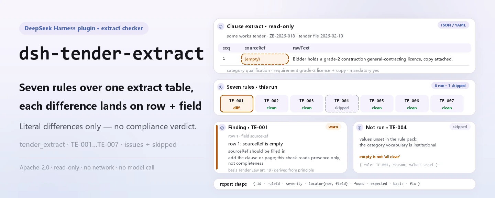
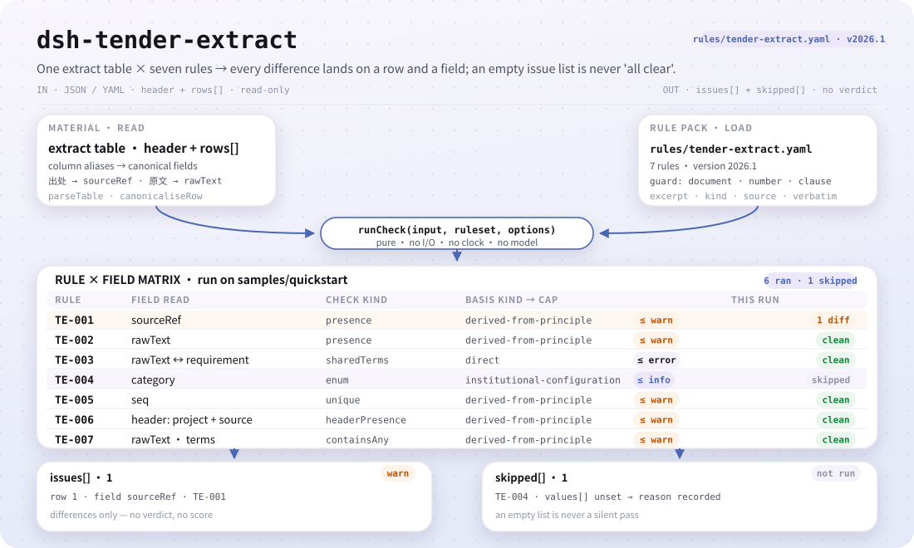
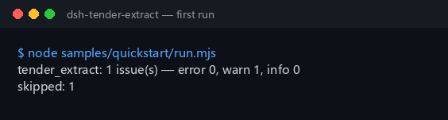

<div align="center">

<picture>
  <source media="(prefers-color-scheme: dark)" srcset="docs/assets/dsh-tender-extract-hero-en-dark.webp">
  
</picture>

# dsh-tender-extract

**Lea una tabla de extractos de cláusulas del pliego y obtenga, fila por fila, qué falla y dónde — solo diferencias, sin veredicto.**

Un verificador DSH para agentes de licitación y licitadores: siete reglas cubren procedencia, texto original, exigencia destilada, categoría, secuencia y marcadores de plantilla, y cada hallazgo indica la fila, el campo y la corrección.

[Instalación](#instalación-en-tres-pasos) · [Configuración](#configuración) · [FAQ](#faq) · [简体中文](README.md) · [English](README.en.md) · [Español](README.es.md) · [Português](README.pt.md) · [हिन्दी](README.hi.md)

[](LICENSE)
[](#compatibilidad)
[](https://www.npmjs.com/package/dsh-tender-extract)
[](https://github.com/PerryLink/dsh-tender-extract/actions/workflows/ci.yml)
[](#compatibilidad)

[](https://github.com/PerryLink/dsh-tender-extract/stargazers)
[](https://www.npmjs.com/package/dsh-tender-extract)
[](https://dshfind.com/plugins/PerryLink/dsh-tender-extract?ref=badge)
[](https://securityscorecards.dev/viewer/?uri=github.com/PerryLink/dsh-tender-extract)
[](https://dsh.market/)
[](https://gitee.com/perrylink/dsh-tender-extract)

```sh
dsh plugin --profile <name> add dsh-tender-extract
```

</div>

<sub>Complemento comunitario, no afiliado a DeepSeek. Repositorio canónico: <https://github.com/PerryLink/dsh-tender-extract> (Gitee es un espejo).</sub>

## Qué es

`dsh-tender-extract` lee una tabla de extractos de cláusulas —la cabecera del expediente más una fila por extracto—, aplica un paquete de reglas versionado y devuelve un informe sobre esa tabla y solo sobre ella: que cada fila indique su procedencia (`sourceRef`), que la columna del texto original (`rawText`) esté cumplimentada, que la exigencia destilada (`requirement`) comparta algún término con ese texto, que la categoría registrada figure en la lista de su institución, que no se repita ningún número de extracto (`seq`), que la cabecera nombre el proyecto y el documento de origen, y que no quede ningún marcador de plantilla en el texto original. El vocabulario de categorías de cláusula viene vacío y, sin nada configurado, `TE-004` se declara en `skipped` en lugar de pasar en silencio.

Para quién: agentes de licitación y licitadores; no hace falta saber usar la línea de comandos. Qué aporta: el material de origen sobre el que trabaja la comprobación (una tabla, un registro o un documento); el original nunca se modifica, y Excel puede convertirse antes a JSON/YAML —en el chat si la plataforma lo permite—. Qué no hace: no dictamina cumplimiento, no determina responsabilidades y no sustituye al revisor; solo enumera diferencias.

<picture>
  <source media="(prefers-color-scheme: dark)" srcset="docs/assets/dsh-tender-extract-flow-v5-dark.svg">
  
</picture>

## Instalación en tres pasos

1. **Instalar** (elija un canal):

   ```sh
   # canal npm (versiones publicadas)
   dsh plugin --profile web add dsh-tender-extract
   # canal git (última main)
   dsh plugin --profile web add github:PerryLink/dsh-tender-extract
   # canal tarball: tras pnpm pack en este repositorio
   dsh plugin --profile web add ./dsh-tender-extract-<version>.tgz
   ```

   El paquete npm incluye `lib/` ya construido; al instalar desde git o desde un tarball, `lib/index.mjs` (el destino de `main`) debe haberlo generado `pnpm run build`.

2. **Configuración mínima** (los valores por defecto ya funcionan; cambie el paquete de reglas o desactive reglas según necesite):

   ```yaml
   - insert:
       - id: dsh-tender-extract
         name: dsh-tender-extract
         config:
           rulesFile: rules/tender-extract.yaml
   ```

3. **Comprobar que se montó**:

   ```sh
   dsh --profile web --dump-config | grep 'dsh-tender-extract'
   node samples/quickstart/run.mjs --check
   ```

   ```
   tender_extract: 1 issue(s) — error 0, warn 1, info 0
   skipped: 1
   ```

   Los ejemplos están en `samples/quickstart/input/` y la salida esperada en `samples/quickstart/expected/result.json`; un checkout del código fuente necesita `pnpm run build` antes. Captura real de la primera ejecución:

   

**Desinstalar**: `dsh plugin --profile web remove dsh-tender-extract` (o elimine la fila del patch del perfil).

> Busque «Tender Compliance Suite» en WorkBuddy / Coze (esta comprobación es una de sus partes; disponibilidad según catálogo); la entrada por línea de comandos es el comando `dsh plugin` de arriba.

## Capacidades principales

`dsh-tender-extract` comprueba la **integridad y coherencia interna de la propia tabla de extractos** — nunca juzga si un extracto está completo y nunca emite un veredicto de cumplimiento. Las siete reglas vienen de un paquete de reglas sustituible:

| Regla | Qué comprueba | Gravedad | Tipo de base |
|---|---|---|---|
| `TE-001` | cada extracto da su procedencia (`sourceRef`) | `warn` | `derived-from-principle` |
| `TE-002` | cada extracto registra el texto original (`rawText`) | `warn` | `derived-from-principle` |
| `TE-003` | la exigencia comparte términos con el texto original | `warn` | `direct` |
| `TE-004` | la categoría procede de su vocabulario (desactivada de fábrica) | `info` | `institutional-configuration` |
| `TE-005` | los números de extracto son únicos | `warn` | `derived-from-principle` |
| `TE-006` | la tabla nombra el proyecto y el documento de origen | `warn` | `derived-from-principle` |
| `TE-007` | el texto original no conserva marcadores de plantilla | `warn` | `derived-from-principle` |

- **Un informe localizable.** Cada hallazgo es `{ id, ruleId, severity, locator, found, expected, fix }`: `locator` señala la fila y el campo, y `fix` es una frase accionable. El informe solo enumera diferencias: ni ranking ni puntuación.
- **Un resultado vacío no es un certificado.** Toda comprobación que no pudo ejecutarse aparece en `skipped` con su motivo; así se declara `TE-004` mientras el vocabulario de categorías está vacío, en vez de pasar en silencio.
- **El paquete de reglas es dato.** Las siete reglas viven en `rules/tender-extract.yaml`; sustituir el archivo cambia el conjunto de reglas. La carga valida que `document` / `number` / `clause` / `excerpt` / `kind` / `source` estén presentes y que `excerpt` sea una cita literal.
- **Solo lectura, determinista, sin modelo.** Sin red, sin llamada al modelo y sin escritura de archivos; toda la aritmética es de hora local sobre las cadenas de entrada, sin conversión de zona horaria.

### Cómo es el informe

Abajo está la salida real contra el fixture `TE-003`, no una ilustración.

**Herramienta** `tender_extract`

**Entrada**

```json
{"rows":[{"原文":"甲乙丙丁戊己庚辛","要求":"一二三四五六七八"}]}
```

**Salida**

```json
{
  "id": "dsh-tender-extract.TE-003.de09b5a6",
  "ruleId": "TE-003",
  "severity": "warn",
  "locator": {
    "row": 1,
    "field": "requirement"
  },
  "found": "第 1 行「requirement」与「rawText」没有共同词（共同词 0 个，配置下限 2 个）",
  "expected": "「requirement」应与「rawText」在字面上相关",
  "fix": "本条只提示两栏看不出关系、值得人工复核，不断言提炼有误；同义改写会拉低共同词数，可调整 minShared"
}
```

*Observado en `dsh-tender-extract/tests/fixtures/TE-003/TE-003-unsafe.json`*

## Configuración

Todos los parámetros ajustables son campos Schemastery `Config` en `src/config.ts` y se cambian desde `cordis.yml` sin tocar el código; los umbrales por regla están en el paquete de reglas bajo `rules/`. Una sustitución dirigida por id reemplaza la fila entera: repita todas las claves que necesite.

| Clave | Tipo | Predeterminado | Descripción |
|---|---|---|---|
| `rulesFile` | string | `rules/tender-extract.yaml` | Ruta del paquete de reglas, relativa a la raíz del paquete |
| `disabledRules` | string[] | `[]` | Ids de reglas que se dejan de ejecutar; cada una aparece en `skipped` |
| `onlyRules` | string[] | `[]` | Ejecutar solo estas reglas; vacío ejecuta todas |
| `skipNotes` | string | `""` | Nota añadida a cada motivo de `skipped` |
| `timeoutMs` | number | `120000` | Presupuesto de tiempo de espera cooperativo de la herramienta |

Parámetros por regla (dentro de `params` del paquete de reglas):

- `TE-003` `leftField` / `rightField` / `minShared`: las dos columnas y el mínimo de términos compartidos, `2` por defecto. Póngalo en `1` para ser más permisivo; el mínimo es **una convención local, no una cifra normativa**.
- `TE-004` `values`: sus categorías de cláusula, p. ej. `[qualification, technical-specification, commercial-terms, evaluation-method, contract-terms]`; vacío significa que no se comprueba.
- `TE-007` `terms`: los marcadores que se buscan. El marcador de pasaje omitido está deliberadamente **ausente**: es una forma normal de abreviar una cláusula larga, así que no se trata como marcador. Si su plantilla realmente lo usa para sustituir una cláusula entera, añádalo usted mismo a `terms`.

Ejemplo de sustitución en el patch del perfil:

```yaml
- insert:
    - id: dsh-tender-extract
      name: dsh-tender-extract
      config:
        disabledRules: [TE-007]
        skipNotes: Los marcadores de plantilla quedan fuera del alcance de este proyecto
```

## Formato del material

La herramienta acepta JSON o YAML:

```yaml
project: 某某工程施工招标
tenderNo: ZB-2026-018
source: 招标文件 2026-02-10 版
rows:
  - { 序号: '1', 出处: 第三章 第 3.2 条,
      原文: 投标人应具有建筑工程施工总承包二级及以上资质，并附资质证书复印件。,
      类别: 资格条件, 要求: 需具备建筑工程施工总承包二级及以上资质并提供证书复印件,
      是否实质性: 是, 响应: 需响应, 责任部门: 经营部 }
```

Los nombres de columna se comparan sin distinguir mayúsculas y minúsculas y sin contar espacios, guiones bajos ni guiones; se conservan los nombres propios de la tabla, de modo que cada hallazgo nombra la columna que leyó.

## FAQ

<details>
<summary>Falta una cláusula en mi tabla. ¿Lo detecta el plugin?</summary>

No. Decidir si un extracto está *completo* exige compararlo con el pliego entero, y **este plugin solo ve la tabla de extractos**. `TE-001` comprueba que la procedencia esté *registrada*, nunca que el extracto sea exhaustivo, y no afirma lo contrario.

</details>

<details>
<summary>La columna del texto original está rellenada: ¿confirma el plugin que coincide palabra por palabra con el pliego?</summary>

No. `TE-002` solo comprueba que la columna `rawText` esté cumplimentada; no coteja ese texto con el pliego, lo que exige tener el documento original a mano.

</details>

<details>
<summary>La exigencia destilada parece venir de otro sitio por completo. ¿Se señalará?</summary>

`TE-003` busca términos compartidos entre `requirement` y `rawText` —bigramas Han solapados y palabras latinas completas— e informa de la fila cuando no comparten nada. Parafrasear cambia legítimamente las palabras, así que un hallazgo significa que las dos columnas parecen no tener relación y merecen una mirada humana, nunca que la destilación sea errónea. Tampoco detecta una destilación equivocada que sí comparta vocabulario, y el umbral `minShared` de `2` es una convención local, no una cifra normativa.

</details>

<details>
<summary>Todavía no hemos decidido cómo clasificar nuestras cláusulas. ¿Qué pasa con la columna de categoría?</summary>

Sus valores vienen vacíos, así que `TE-004` se declara en `skipped` en lugar de pasar en silencio hasta que los rellene. Una vez configurado solo comprueba que el valor registrado figure en su lista; no decide a qué categoría pertenece una cláusula.

</details>

<details>
<summary>¿Dónde se guardan los datos? ¿Llama a la red o a un modelo?</summary>

A ninguno de los dos. El plugin lee el material que usted indica, con `writes` vacío y `network: false`, y nunca llama a un modelo; el informe se genera en memoria y se devuelve —sin subida ni servicio externo— y el archivo original no se modifica.

</details>

## Límites de seguridad

- **La tabla de extractos es toda la entrada.** Decidir si un extracto está completo exige el pliego entero, y este plugin solo ve la tabla; no puede demostrar que falte una cláusula, solo expone los puntos en que el registro no cuadra.
- **El único juicio de contenido es deliberadamente débil.** `TE-003` solo busca términos compartidos entre el texto original y la exigencia destilada, e informa solo cuando no comparten nada; un hallazgo significa «estas dos columnas parecen no tener relación, merecen una mirada humana», nunca «la destilación es errónea».
- **Disciplina de citas.** Cada `excerpt` del paquete de reglas es una cita literal (sustituida regla por regla el 2026-10-07; el registro de verificación está en `rules/evidence/`), y la fuerza de la base se declara en `kind`: `derived-from-principle` con tope `warn`, `institutional-configuration` con tope `info`, y solo `TE-003` es `direct`. Un paquete que exagere su base falla al cargar en lugar de producir un informe que parezca sólido.
- **Una lista vacía se declara.** El vocabulario de categorías viene vacío; sin configurar nada, `TE-004` queda en `skipped` en vez de pasar en silencio.
- **Sin lenguaje que adjudique.** El informe no se pronuncia sobre cumplimiento, responsabilidad ni corrección; un guardián de redacción bloquea esas afirmaciones y el informe siempre lleva el descargo de responsabilidad.
- **Solo lectura y sin conexión.** Lee el material que el usuario indica, con `writes` vacío y `network: false`; ninguna llamada al modelo y ningún contenido enviado a servicio alguno.
- **El guardián de citas tiene un límite objetivo.** El guardián de carga puede exigir que `excerpt` tenga al menos ocho caracteres, pero no distingue una cita de una descripción; por eso el paquete también se apoya en la cabecera, en el `note` de cada regla y en una prueba que verifica que cada `excerpt` declara su estado de verificación con veracidad.

### Normas que sigue

| Documento | Número | Reglas que lo citan |
|---|---|---|
| 《中华人民共和国招标投标法》 | 1999年8月30日通过，2017年12月27日修正（全国人大常委会《关于修改〈中华人民共和国招标投标法〉、〈中华人民共和国计量法〉的决定》），本法自2000年1月1日起施行 | TE-001, TE-002, TE-003, TE-004, TE-005, TE-006, TE-007 |

**Límite:** este plugin comprueba una **tabla de extractos de cláusulas del pliego** en lo que una lista de verificación puede exigir — que cada extracto dé su procedencia, que el texto original de la cláusula quede registrado, que la exigencia destilada guarde alguna relación léxica con ese texto, que la categoría proceda de su vocabulario, que los números sean únicos y que no quede ningún marcador.

## Limitaciones conocidas

- **No puede demostrar que falte una cláusula.** La exhaustividad solo se juzga contra el pliego entero, que este plugin nunca ve; `TE-001` solo comprueba que la procedencia esté registrada.
- **`TE-002` no compara el texto.** Solo comprueba que la columna del texto original esté cumplimentada; confirmar una coincidencia palabra por palabra exige el pliego en mano.
- **Tres límites de `TE-003`.** La paráfrasis reduce el número de términos compartidos y puede provocar un aviso; una destilación errónea que conserve el vocabulario no se detecta; el umbral `minShared` de `2` es una convención local, no una cifra normativa.
- **`TE-005` solo encuentra repeticiones.** Compara los valores de `seq` ignorando diferencias de espaciado; no juzga si la numeración es sensata por lo demás.
- **`TE-007` solo ve su lista de términos.** Coincide con la lista de fábrica y no ve estilos de marcador fuera de ella; el marcador de pasaje omitido está deliberadamente ausente porque es una forma normal de abreviar una cláusula larga.
- **Seis reglas no son `direct`.** `TE-001` / `TE-002` / `TE-005` / `TE-006` / `TE-007` se apoyan en cláusulas de principio y `TE-004` en configuración local, así que la gravedad queda topada en `warn` / `info`; solo `TE-003` es `direct`.
- **Problema conocido del verificador estático.** `check` puede informar `manifest-peers` como fallo porque compara con un rango de peers codificado que es anterior a la línea 0.2; el runtime aplica la compatibilidad de peers al instalar.

La lista de términos de fábrica de `TE-007`, literal de `rules/tender-extract.yaml`:

```text
【  】  {{  }}  XXX  xxx  待填  待补充  TBD  todo  示例
Ausente a propósito: （略） — «……（略）» es una forma normal de abreviar una cláusula larga.
```

## Compatibilidad

| Superficie | Estado |
|---|---|
| Harness | Rango de peers `>=0.1.2-rc.1 <0.2.0 \|\| >=0.2.0-0 <0.3.0` — verificado para aceptar tanto `0.2.0-rc.2` como `0.2.1-rc.2`. **`engines.dsh` se declara como `>=0.2.1-0 <0.3.0`** y el host lo aplica desde 0.2.1 |
| Node | `^22.19.0 \|\| >=24.0.0` |
| Plataformas | Todas (ESM puro; sin código nativo, sin red, sin llamada al modelo) |
| Modo de herramienta | Funciona en `native` y `ptc`; para un directorio completo use `ptc` |

## Ecosistema y calidad

- [Espejo Gitee](https://gitee.com/perrylink/dsh-tender-extract) (espejo sincronizado; GitHub es la referencia)
- [Página dshfind](https://dshfind.com/plugins/PerryLink/dsh-tender-extract) (instalaciones y ranking)
- [Informe OpenSSF Scorecard](https://securityscorecards.dev/viewer/?uri=github.com/PerryLink/dsh-tender-extract) (impulsado por [.github/workflows/scorecard.yml](.github/workflows/scorecard.yml))
- [DSH Market](https://dsh.market/) (publicado)
- [Elija un verificador por material](https://perrylink.github.io/zh/checkers/choose/) (índice de la familia PerryLink)

## Solución de problemas

- **El plugin se instala pero la herramienta no aparece.** Compruebe que `main` resuelve a `lib/index.mjs` y que `pnpm run build` lo generó; un `main` erróneo hace que el cargador omita la entrada en silencio.
- **`dsh plugin add` rechaza el paquete por incompatibilidad.** El rango de peers cubre `0.1.x` y `0.2.x`; si su runtime queda fuera, conceda una exención explícita: `dsh plugin --profile <name> allow-version dsh-tender-extract@0.2.12 --dsh-version <runtime> --accept-risk`.
- **Una regla no se ejecutó.** Lea el arreglo `skipped`; allí figuran el id de la regla y el motivo.
- **`check` informa `manifest-peers` como fallo.** El verificador estático compara con un rango de peers codificado anterior a la línea 0.2; el runtime aplica la compatibilidad al instalar. Es un problema conocido de `dsh-plugin-dev`.
- **Un hallazgo se apoya en una base inferida.** `derived-from-principle` / `institutional-configuration` significa que la base no se estableció cláusula por cláusula; trátelo como una laguna de verificación, no como prueba de cumplimiento. El registro está en `rules/evidence/`.
- **Los horarios parecen desplazados.** Toda la aritmética es de hora local sobre las cadenas entregadas; no se hace conversión de zona horaria.

## Desarrollo

```sh
pnpm install
pnpm run typecheck
pnpm test
pnpm run build
pnpm run verify:self-contained
pnpm run check:lockfile
pnpm run check:citations
pnpm run check:readmes
pnpm pack
node ../scripts/sync-shared.mjs dsh-tender-extract
```

`pnpm run build` (tsdown) genera `lib/index.mjs` y `lib/index.d.mts`; `node ../scripts/sync-shared.mjs dsh-tender-extract` copia el kit compartido de `../_shared` a `src/shared/` — vuelva a ejecutarlo tras cada cambio compartido.

| Ruta | Contenido |
|---|---|
| `src/index.ts` | contrato de plugin de función: registra la herramienta `tender_extract` y resuelve el paquete de reglas incluido |
| `src/config.ts` | el esquema Schemastery; todo parámetro ajustable vive aquí |
| `src/check.ts` | núcleo de comprobación puro `(input, ruleset, options) => Report`, sin E/S, reloj ni acceso a modelo |
| `src/parse.ts` | lector de material JSON / YAML |
| `src/view.ts` | proyección del informe orientada al modelo; `output.schema` en `index.ts` la refleja |
| `src/shared/` | kit compartido (carga de reglas, forma del informe, aritmética de calendario, guardián de redacción), copiado en vez de importado |
| `rules/tender-extract.yaml` | el paquete de reglas, 7 reglas |
| `rules/evidence/` | el registro de verificación de cada cita |
| `tests/` | vitest; un fixture conforme y otro infractor por regla |
| `samples/quickstart/` | la muestra de un minuto y su salida esperada |
| `docs/assets/` | imágenes del README |
| `scripts/` | verificadores, comprobación de citas y generador de imágenes |

Las imágenes del README las genera programáticamente [`scripts/gen-readme-assets.py`](scripts/gen-readme-assets.py) (Python + Pillow para el hero WebP claro y oscuro, SVG estructural escrito a mano en claro y oscuro) y se puede volver a ejecutar: `python scripts/gen-readme-assets.py`.

Topics: `dsh`, `dsh-plugin`, `deepseek-harness`, `deepseek`, `cordis`, `tender`, `extract`

## Familia y agradecimientos

Este proyecto forma parte de la familia de plugins de DeepSeek Harness de [PerryLink](https://github.com/PerryLink) (todos Apache-2.0). Si le resulta útil, **una estrella ayuda a que la siguiente persona lo encuentre** — no desbloquea nada.

- [@PerryLink](https://github.com/PerryLink) — creador y mantenedor: diseño del paquete de reglas, motor de comprobación, registro de verificación de cláusulas y documentación en cinco idiomas.

<details>
<summary>Desplegar todos los plugins</summary>

| Plugin | Estado |
|---|---|
| **[dsh-aqua-input-check](https://github.com/PerryLink/dsh-aqua-input-check)** |  |
| **[dsh-archive-check](https://github.com/PerryLink/dsh-archive-check)** |  |
| **[dsh-auto-review](https://github.com/PerryLink/dsh-auto-review)** |  |
| **[dsh-autotier](https://github.com/PerryLink/dsh-autotier)** | 🧊 CONGELADO — ver el README del repo |
| **[dsh-bid-ca-precheck](https://github.com/PerryLink/dsh-bid-ca-precheck)** |  |
| **[dsh-bid-qual-check](https://github.com/PerryLink/dsh-bid-qual-check)** |  |
| **[dsh-cert-mcp](https://github.com/PerryLink/dsh-cert-mcp)** | 🧊 CONGELADO — ver el README del repo |
| **[dsh-checkpoint-rewind](https://github.com/PerryLink/dsh-checkpoint-rewind)** |  |
| **[dsh-click](https://github.com/PerryLink/dsh-click)** |  |
| **[dsh-composer-history](https://github.com/PerryLink/dsh-composer-history)** |  |
| **[dsh-contract-stance](https://github.com/PerryLink/dsh-contract-stance)** |  |
| **[dsh-customs-doc-check](https://github.com/PerryLink/dsh-customs-doc-check)** |  |
| **[dsh-data-quality](https://github.com/PerryLink/dsh-data-quality)** | 🧊 CONGELADO — ver el README del repo |
| **[dsh-demurrage-ledger](https://github.com/PerryLink/dsh-demurrage-ledger)** |  |
| **[dsh-doublecheck](https://github.com/PerryLink/dsh-doublecheck)** |  |
| **[dsh-drill-script-check](https://github.com/PerryLink/dsh-drill-script-check)** |  |
| **[dsh-eia-guide-check](https://github.com/PerryLink/dsh-eia-guide-check)** |  |
| **[dsh-emergency-plan](https://github.com/PerryLink/dsh-emergency-plan)** |  |
| **[dsh-essay-rubric-check](https://github.com/PerryLink/dsh-essay-rubric-check)** |  |
| **[dsh-evidence-check](https://github.com/PerryLink/dsh-evidence-check)** |  |
| **[dsh-export-ctl-check](https://github.com/PerryLink/dsh-export-ctl-check)** |  |
| **[dsh-fast](https://github.com/PerryLink/dsh-fast)** |  |
| **[dsh-fmea-table-check](https://github.com/PerryLink/dsh-fmea-table-check)** |  |
| **[dsh-forecast-penalty](https://github.com/PerryLink/dsh-forecast-penalty)** |  |
| **[dsh-fund-research](https://github.com/PerryLink/dsh-fund-research)** |  |
| **[dsh-github](https://github.com/PerryLink/dsh-github)** |  |
| **[dsh-gongwen-flow-check](https://github.com/PerryLink/dsh-gongwen-flow-check)** |  |
| **[dsh-gongwen-word-check](https://github.com/PerryLink/dsh-gongwen-word-check)** |  |
| **[dsh-guard-plan-qc](https://github.com/PerryLink/dsh-guard-plan-qc)** |  |
| **[dsh-hazchem-check](https://github.com/PerryLink/dsh-hazchem-check)** |  |
| **[dsh-hazplan-check](https://github.com/PerryLink/dsh-hazplan-check)** |  |
| **[dsh-hidden-risk-map](https://github.com/PerryLink/dsh-hidden-risk-map)** |  |
| **[dsh-hs-classify](https://github.com/PerryLink/dsh-hs-classify)** |  |
| **[dsh-icd-rule-check](https://github.com/PerryLink/dsh-icd-rule-check)** |  |
| **[dsh-industry-research](https://github.com/PerryLink/dsh-industry-research)** |  |
| **[dsh-lawcite-adapter](https://github.com/PerryLink/dsh-lawcite-adapter)** |  |
| **[dsh-laya](https://github.com/PerryLink/dsh-laya)** |  |
| **[dsh-lc-doc-check](https://github.com/PerryLink/dsh-lc-doc-check)** |  |
| **[dsh-learning-gap-check](https://github.com/PerryLink/dsh-learning-gap-check)** |  |
| **[dsh-library](https://github.com/PerryLink/dsh-library)** |  |
| **[dsh-local-ai](https://github.com/PerryLink/dsh-local-ai)** |  |
| **[dsh-lsp-actions](https://github.com/PerryLink/dsh-lsp-actions)** |  |
| **[dsh-mask](https://github.com/PerryLink/dsh-mask)** |  |
| **[dsh-mcp-panel](https://github.com/PerryLink/dsh-mcp-panel)** |  |
| **[dsh-medrec-qc](https://github.com/PerryLink/dsh-medrec-qc)** |  |
| **[dsh-memento](https://github.com/PerryLink/dsh-memento)** | 🧊 CONGELADO — ver el README del repo |
| **[dsh-nsfc-form-check](https://github.com/PerryLink/dsh-nsfc-form-check)** |  |
| **[dsh-nurse-record-check](https://github.com/PerryLink/dsh-nurse-record-check)** |  |
| **[dsh-observe](https://github.com/PerryLink/dsh-observe)** |  |
| **[dsh-origin-rvc-check](https://github.com/PerryLink/dsh-origin-rvc-check)** |  |
| **[dsh-ota-review-check](https://github.com/PerryLink/dsh-ota-review-check)** |  |
| **[dsh-output-styles](https://github.com/PerryLink/dsh-output-styles)** |  |
| **[dsh-paper-doc-adapter](https://github.com/PerryLink/dsh-paper-doc-adapter)** |  |
| **[dsh-permission-rules](https://github.com/PerryLink/dsh-permission-rules)** |  |
| **[dsh-permit-report-check](https://github.com/PerryLink/dsh-permit-report-check)** |  |
| **[dsh-pipeline-check](https://github.com/PerryLink/dsh-pipeline-check)** |  |
| **[dsh-pleading-draft](https://github.com/PerryLink/dsh-pleading-draft)** |  |
| **[dsh-plugin-doctor](https://github.com/PerryLink/dsh-plugin-doctor)** | 🚫 RETIRADO (repo archivado) |
| **[dsh-plugin-guide](https://github.com/PerryLink/dsh-plugin-guide)** |  |
| **[dsh-plugin-kit](https://github.com/PerryLink/dsh-plugin-kit)** | 🚫 RETIRADO (repo archivado) |
| **[dsh-plugin-upgrade](https://github.com/PerryLink/dsh-plugin-upgrade)** | 🚫 RETIRADO (repo archivado) |
| **[dsh-policy-brief-draft](https://github.com/PerryLink/dsh-policy-brief-draft)** |  |
| **[dsh-power-loss-split](https://github.com/PerryLink/dsh-power-loss-split)** |  |
| **[dsh-power-ticket-check](https://github.com/PerryLink/dsh-power-ticket-check)** |  |
| **[dsh-ppap-check](https://github.com/PerryLink/dsh-ppap-check)** |  |
| **[dsh-protest-deadline](https://github.com/PerryLink/dsh-protest-deadline)** |  |
| **[dsh-railway-window](https://github.com/PerryLink/dsh-railway-window)** |  |
| **[dsh-repair-order-qc](https://github.com/PerryLink/dsh-repair-order-qc)** |  |
| **[dsh-research-report](https://github.com/PerryLink/dsh-research-report)** |  |
| **[dsh-review-reply-check](https://github.com/PerryLink/dsh-review-reply-check)** |  |
| **[dsh-rulefile-check](https://github.com/PerryLink/dsh-rulefile-check)** |  |
| **[dsh-safety-brief-check](https://github.com/PerryLink/dsh-safety-brief-check)** |  |
| **[dsh-score](https://github.com/PerryLink/dsh-score)** | 🧊 CONGELADO — ver el README del repo |
| **[dsh-session-sync](https://github.com/PerryLink/dsh-session-sync)** |  |
| **[dsh-site-log-check](https://github.com/PerryLink/dsh-site-log-check)** |  |
| **[dsh-skill-pack-security](https://github.com/PerryLink/dsh-skill-pack-security)** |  |
| **[dsh-soe-decision-check](https://github.com/PerryLink/dsh-soe-decision-check)** |  |
| **[dsh-soilwater-check](https://github.com/PerryLink/dsh-soilwater-check)** |  |
| **[dsh-sop-sync-check](https://github.com/PerryLink/dsh-sop-sync-check)** |  |
| **[dsh-spc-gbt-adapter](https://github.com/PerryLink/dsh-spc-gbt-adapter)** |  |
| **[dsh-talk](https://github.com/PerryLink/dsh-talk)** |  |
| **[dsh-tender-extract](https://github.com/PerryLink/dsh-tender-extract)** |  |
| **[dsh-tender-matrix](https://github.com/PerryLink/dsh-tender-matrix)** |  |
| **[dsh-test-drive](https://github.com/PerryLink/dsh-test-drive)** |  |
| **[dsh-ticktick](https://github.com/PerryLink/dsh-ticktick)** | 🚫 RETIRADO (repo archivado) |
| **[dsh-translate](https://github.com/PerryLink/dsh-translate)** |  |
| **[dsh-warranty-calc](https://github.com/PerryLink/dsh-warranty-calc)** |  |
| **[dsh-budget](https://github.com/PerryLink/dsh-budget)** | 🧊 CONGELADO — ver el README del repo |
| **[dsh-claude-move](https://github.com/PerryLink/dsh-claude-move)** | 🧊 CONGELADO — ver el README del repo |
| **[dsh-defend](https://github.com/PerryLink/dsh-defend)** | 🧊 CONGELADO — ver el README del repo |
| **[dsh-draw](https://github.com/PerryLink/dsh-draw)** | 🧊 CONGELADO — ver el README del repo |
| **[dsh-reach](https://github.com/PerryLink/dsh-reach)** | 🧊 CONGELADO — ver el README del repo |
| **[dsh-background-agents](https://github.com/PerryLink/dsh-background-agents)** | 🚫 RETIRADO (repo archivado) |
| **[dsh-session-pin](https://github.com/PerryLink/dsh-session-pin)** | 🚫 RETIRADO (repo archivado) |
| **[dsh-team-rooms](https://github.com/PerryLink/dsh-team-rooms)** | 🚫 RETIRADO (repo archivado) |

</details>

## License

[LICENSE](LICENSE) (Apache License 2.0) © 2026 dsh-tender-extract contributors

<p align="center"><sub>Apache-2.0 · Complemento comunitario, no afiliado a DeepSeek.</sub></p>
