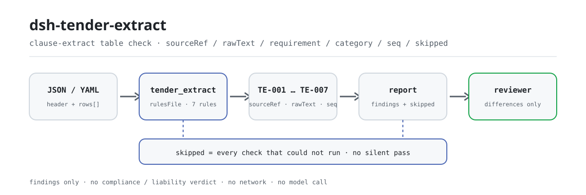
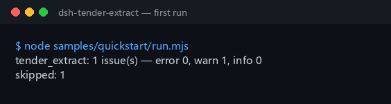

<div align="center">

<picture>
  <source media="(prefers-color-scheme: dark)" srcset="docs/assets/dsh-tender-extract-flow-dark.svg">
  
</picture>

# dsh-tender-extract

**टेंडर की खंड-उद्धरण तालिका पढ़िए और पंक्ति-दर-पंक्ति जानिए कि कहाँ क्या गड़बड़ है — केवल अंतर, कोई निर्णय नहीं।**

टेंडर एजेंट और बोली लगाने वालों के लिए DSH जाँच: सात नियम स्रोत, मूल पाठ, निकाली गई अपेक्षा, श्रेणी, क्रमांक और टेम्पलेट प्लेसहोल्डर की जाँच करते हैं, और हर निष्कर्ष पंक्ति, फ़ील्ड और सुधार बताता है।

[इंस्टॉल](#तीन-चरणों-में-शुरुआत) · [कॉन्फ़िगरेशन](#कॉन्फ़िगरेशन) · [FAQ](#faq) · [简体中文](README.md) · [English](README.en.md) · [Español](README.es.md) · [Português](README.pt.md) · [हिन्दी](README.hi.md)

[](LICENSE)
[](#संगतता)
[](https://www.npmjs.com/package/dsh-tender-extract)
[](https://github.com/PerryLink/dsh-tender-extract/actions/workflows/ci.yml)
[](#संगतता)

[](https://github.com/PerryLink/dsh-tender-extract/stargazers)
[](https://www.npmjs.com/package/dsh-tender-extract)
[](https://dshfind.com/plugins/PerryLink/dsh-tender-extract?ref=badge)
[](https://securityscorecards.dev/viewer/?uri=github.com/PerryLink/dsh-tender-extract)
[](https://dsh.market/)
[](https://gitee.com/perrylink/dsh-tender-extract)

```sh
dsh plugin --profile <name> add dsh-tender-extract
```

</div>

<sub>सामुदायिक प्लगइन, DeepSeek से संबद्ध नहीं। मानक रेपो: <https://github.com/PerryLink/dsh-tender-extract> (Gitee एक मिरर है)।</sub>

## यह क्या है

`dsh-tender-extract` एक खंड-उद्धरण तालिका पढ़ता है — सामग्री का हेडर और प्रत्येक उद्धरण की एक पंक्ति —, संस्करणबद्ध नियम-पैक लागू करता है, और केवल उसी तालिका पर रिपोर्ट देता है: हर पंक्ति अपना स्रोत (`sourceRef`) देती है या नहीं, मूल खंड-पाठ का कॉलम (`rawText`) भरा है या नहीं, निकाली गई अपेक्षा (`requirement`) उस मूल पाठ से कुछ शब्द साझा करती है या नहीं, दर्ज श्रेणी आपकी संस्था की सूची में है या नहीं, कोई उद्धरण-क्रमांक (`seq`) दोहराया नहीं गया है या नहीं, हेडर परियोजना और स्रोत दस्तावेज़ का नाम देता है या नहीं, और मूल पाठ में कोई टेम्पलेट प्लेसहोल्डर शेष नहीं है या नहीं। खंड-श्रेणी के मान फ़ैक्टरी में खाली हैं, और कुछ भी कॉन्फ़िगर न होने पर `TE-004` चुपचाप पास होने के बजाय `skipped` में स्वयं को दर्ज करता है।

किसके लिए: टेंडर एजेंट और बोली लगाने वाले; कमांड लाइन जानना ज़रूरी नहीं। आप क्या देते हैं: वह मूल सामग्री जिस पर जाँच चलती है (तालिका, रजिस्टर या दस्तावेज़); मूल फ़ाइल कभी नहीं बदली जाती, और Excel को पहले JSON/YAML में बदला जा सकता है — चैट में भी, अगर प्लेटफ़ॉर्म सुविधा दे। यह क्या नहीं करता: अनुपालन का निर्णय नहीं, दायित्व का निर्धारण नहीं, समीक्षक का विकल्प नहीं; केवल अंतर।

## तीन चरणों में शुरुआत

1. **इंस्टॉल करें** (एक चैनल चुनें):

   ```sh
   # npm चैनल (प्रकाशित संस्करण)
   dsh plugin --profile web add dsh-tender-extract
   # git चैनल (नवीनतम main)
   dsh plugin --profile web add github:PerryLink/dsh-tender-extract
   # tarball चैनल: इस रेपो में pnpm pack के बाद
   dsh plugin --profile web add ./dsh-tender-extract-<version>.tgz
   ```

   npm पैकेज में बना हुआ `lib/` आता है; git या tarball से इंस्टॉल करते समय `lib/index.mjs` (`main` का लक्ष्य) `pnpm run build` से बना होना चाहिए।

2. **न्यूनतम कॉन्फ़िगरेशन** (डिफ़ॉल्ट चलते हैं; ज़रूरत हो तो नियम-पैक बदलें या नियम बंद करें):

   ```yaml
   - insert:
       - id: dsh-tender-extract
         name: dsh-tender-extract
         config:
           rulesFile: rules/tender-extract.yaml
   ```

3. **जाँचें कि माउंट हुआ**:

   ```sh
   dsh --profile web --dump-config | grep 'dsh-tender-extract'
   node samples/quickstart/run.mjs --check
   ```

   ```
   tender_extract: 1 issue(s) — error 0, warn 1, info 0
   skipped: 1
   ```

   नमूने `samples/quickstart/input/` में और अपेक्षित आउटपुट `samples/quickstart/expected/result.json` में हैं; सोर्स चेकआउट के लिए पहले `pnpm run build` चाहिए। पहली बार चलाने का असली कैप्चर:

   

**अनइंस्टॉल**: `dsh plugin --profile web remove dsh-tender-extract` (या प्रोफ़ाइल पैच से वह पंक्ति हटा दें)।

> WorkBuddy / Coze में «Tender Compliance Suite» खोजें (यह जाँच उसका एक हिस्सा है; उपलब्धता कैटलॉग के अनुसार); कमांड लाइन का प्रवेश ऊपर का `dsh plugin` कमांड है।

## मुख्य क्षमताएँ

`dsh-tender-extract` केवल **उद्धरण तालिका की अपनी पूर्णता और आंतरिक सुसंगति** जाँचता है — यह कभी नहीं आँकता कि कोई उद्धरण पूरा है या नहीं, और कभी अनुपालन का निर्णय नहीं देता। सातों नियम बदले जा सकने वाले नियम-पैक से आते हैं:

| नियम | क्या जाँचता है | गंभीरता | आधार प्रकार |
|---|---|---|---|
| `TE-001` | हर उद्धरण अपना स्रोत (`sourceRef`) देता है | `warn` | `derived-from-principle` |
| `TE-002` | हर उद्धरण मूल पाठ (`rawText`) दर्ज करता है | `warn` | `derived-from-principle` |
| `TE-003` | अपेक्षा मूल पाठ से शब्द साझा करती है | `warn` | `direct` |
| `TE-004` | श्रेणी आपके शब्दावली से आती है (फ़ैक्टरी में बंद) | `info` | `institutional-configuration` |
| `TE-005` | उद्धरण-क्रमांक अद्वितीय हैं | `warn` | `derived-from-principle` |
| `TE-006` | तालिका परियोजना और स्रोत दस्तावेज़ का नाम देती है | `warn` | `derived-from-principle` |
| `TE-007` | मूल पाठ में कोई टेम्पलेट प्लेसहोल्डर नहीं बचा | `warn` | `derived-from-principle` |

- **स्थान बताने वाली रिपोर्ट।** हर निष्कर्ष `{ id, ruleId, severity, locator, found, expected, fix }` है: `locator` पंक्ति और फ़ील्ड बताता है, और `fix` एक कार्रवाई योग्य वाक्य है। रिपोर्ट केवल अंतर गिनाती है — कोई रैंकिंग नहीं, कोई स्कोर नहीं।
- **खाली परिणाम प्रमाणपत्र नहीं है।** जो भी जाँच नहीं चल सकी, वह कारण के साथ `skipped` में जाती है; श्रेणी-शब्दावली खाली रहने पर `TE-004` इसी तरह स्वयं को दर्ज करता है, चुपचाप पास नहीं होता।
- **नियम-पैक डेटा है।** सातों नियम `rules/tender-extract.yaml` में हैं; फ़ाइल बदलने से नियम-समुच्चय बदल जाता है। लोड पर जाँच होती है कि `document` / `number` / `clause` / `excerpt` / `kind` / `source` मौजूद हैं और `excerpt` शब्दशः उद्धरण है।
- **केवल पढ़ता है, नियतात्मक, मॉडल-रहित।** कोई नेटवर्क नहीं, कोई मॉडल कॉल नहीं, कोई फ़ाइल लेखन नहीं; सारी गणना इनपुट स्ट्रिंग पर वॉल-क्लॉक है, कोई टाइमज़ोन रूपांतरण नहीं।

### रिपोर्ट कैसी दिखती है

नीचे `TE-003` फ़िक्स्चर पर वास्तविक आउटपुट है, कोई चित्रण नहीं।

**उपकरण** `tender_extract`

**इनपुट**

```json
{"rows":[{"原文":"甲乙丙丁戊己庚辛","要求":"一二三四五六七八"}]}
```

**आउटपुट**

```json
{
  "id": "dsh-tender-extract.TE-003.de09b5a6",
  "ruleId": "TE-003",
  "severity": "warn",
  "locator": {
    "row": 1,
    "field": "requirement"
  },
  "found": "第 1 行「requirement」与「rawText」没有共同词（共同词 0 个，配置下限 2 个）",
  "expected": "「requirement」应与「rawText」在字面上相关",
  "fix": "本条只提示两栏看不出关系、值得人工复核，不断言提炼有误；同义改写会拉低共同词数，可调整 minShared"
}
```

*स्रोत `dsh-tender-extract/tests/fixtures/TE-003/TE-003-unsafe.json`*

## कॉन्फ़िगरेशन

सभी समायोज्य पैरामीटर `src/config.ts` की Schemastery `Config` फ़ील्ड हैं और कोड बदले बिना `cordis.yml` से बदले जा सकते हैं; प्रति-नियम सीमाएँ `rules/` के नियम-पैक में हैं। id के अनुसार ओवरराइड पूरी पंक्ति बदल देता है — ज़रूरी सभी कुंजियाँ दोहराएँ।

| कुंजी | प्रकार | डिफ़ॉल्ट | विवरण |
|---|---|---|---|
| `rulesFile` | string | `rules/tender-extract.yaml` | नियम-पैक का पथ, पैकेज रूट के सापेक्ष |
| `disabledRules` | string[] | `[]` | बंद करने वाले नियम id; प्रत्येक `skipped` में दिखता है |
| `onlyRules` | string[] | `[]` | केवल ये नियम चलाएँ; खाली होने पर सभी नियम चलते हैं |
| `skipNotes` | string | `""` | हर `skipped` कारण के आगे जोड़ी जाने वाली टिप्पणी |
| `timeoutMs` | number | `120000` | उपकरण का सहकारी समय-सीमा बजट |

प्रति-नियम पैरामीटर (नियम-पैक के `params` में):

- `TE-003` `leftField` / `rightField` / `minShared`: दोनों कॉलम और साझा शब्दों की न्यूनतम सीमा, डिफ़ॉल्ट `2`। अधिक उदार होने के लिए `1` रखें; यह सीमा **स्थानीय परिपाटी है, कोई मानक संख्या नहीं**।
- `TE-004` `values`: आपकी खंड-श्रेणियाँ, जैसे `[qualification, technical-specification, commercial-terms, evaluation-method, contract-terms]`; खाली यानी कोई जाँच नहीं।
- `TE-007` `terms`: खोजे जाने वाले प्लेसहोल्डर। छोड़े गए अंश का चिह्न जानबूझकर **सूची में नहीं** है: लंबे खंड को छोटा करने का वह सामान्य तरीका है, इसलिए उसे प्लेसहोल्डर नहीं माना जाता। अगर आपका टेम्पलेट वाकई इसे पूरे खंड के बदले इस्तेमाल करता है, तो इसे स्वयं `terms` में जोड़ें।

प्रोफ़ाइल पैच में ओवरराइड का उदाहरण:

```yaml
- insert:
    - id: dsh-tender-extract
      name: dsh-tender-extract
      config:
        disabledRules: [TE-007]
        skipNotes: इस परियोजना में टेम्पलेट प्लेसहोल्डर जाँच के दायरे से बाहर हैं
```

## सामग्री प्रारूप

उपकरण JSON या YAML स्वीकार करता है:

```yaml
project: 某某工程施工招标
tenderNo: ZB-2026-018
source: 招标文件 2026-02-10 版
rows:
  - { 序号: '1', 出处: 第三章 第 3.2 条,
      原文: 投标人应具有建筑工程施工总承包二级及以上资质，并附资质证书复印件。,
      类别: 资格条件, 要求: 需具备建筑工程施工总承包二级及以上资质并提供证书复印件,
      是否实质性: 是, 响应: 需响应, 责任部门: 经营部 }
```

कॉलम नाम बड़े/छोटे अक्षरों में अंतर किए बिना और स्पेस, अंडरस्कोर व हाइफ़न छोड़कर मिलाए जाते हैं; तालिका के अपने कॉलम नाम बने रहते हैं, इसलिए हर निष्कर्ष उसी कॉलम का नाम लेता है जिसे उसने पढ़ा।

## FAQ

<details>
<summary>मेरी तालिका से एक खंड छूट गया है। क्या प्लगइन उसे पकड़ लेगा?</summary>

नहीं। यह तय करना कि कोई उद्धरण *पूरा* है या नहीं, पूरे टेंडर दस्तावेज़ से तुलना माँगता है, और **यह प्लगइन केवल उद्धरण तालिका देखता है**। `TE-001` यह देखता है कि स्रोत *दर्ज* है, यह कभी नहीं कि उद्धरण संपूर्ण है, और इसके विपरीत कुछ नहीं कहता।

</details>

<details>
<summary>मूल पाठ का कॉलम भरा हुआ है — क्या प्लगइन पुष्टि करता है कि वह टेंडर दस्तावेज़ से शब्द-दर-शब्द मेल खाता है?</summary>

नहीं। `TE-002` केवल यह देखता है कि `rawText` कॉलम भरा है; यह उस पाठ की टेंडर दस्तावेज़ से तुलना नहीं करता, उस तुलना के लिए मूल दस्तावेज़ हाथ में होना चाहिए।

</details>

<details>
<summary>निकाली गई अपेक्षा किसी और ही जगह से आई लगती है। क्या यह चिह्नित होगा?</summary>

`TE-003` देखता है कि `requirement` और `rawText` में कुछ शब्द साझा हैं या नहीं — अतिव्यापी हान द्विग्राम और पूर्ण लातिनी शब्द — और जहाँ कुछ भी साझा न हो वह पंक्ति दर्ज करता है। भावानुवाद स्वाभाविक रूप से शब्द बदल देता है, इसलिए यह संकेत का अर्थ है कि ये दोनों कॉलम असंबद्ध दिखते हैं और मानवीय समीक्षा योग्य हैं, यह कभी नहीं कि निष्कर्ष गलत है। यह ऐसा गलत निष्कर्ष भी नहीं पकड़ सकता जिसमें शब्द साझा हों, और `minShared` की सीमा `2` एक स्थानीय परिपाटी है, कोई मानक संख्या नहीं।

</details>

<details>
<summary>हमने अभी तय नहीं किया कि खंडों का वर्गीकरण कैसे करेंगे। श्रेणी कॉलम का क्या होगा?</summary>

इसके मान फ़ैक्टरी में खाली हैं, इसलिए जब तक आप उन्हें न भरें `TE-004` चुपचाप पास होने के बजाय `skipped` में स्वयं को दर्ज करता है। कॉन्फ़िगर होने के बाद यह केवल देखता है कि दर्ज मान आपकी सूची में है; यह तय नहीं करता कि कोई खंड किस श्रेणी में आता है।

</details>

<details>
<summary>डेटा कहाँ रहता है? क्या यह नेटवर्क या मॉडल से जुड़ता है?</summary>

किसी से भी नहीं। प्लगइन वही सामग्री पढ़ता है जो आप बताते हैं, `writes` खाली और `network: false` है, और कभी मॉडल नहीं बुलाता; रिपोर्ट मेमोरी में बनकर लौटती है — कोई अपलोड नहीं, कोई बाहरी सेवा नहीं — और मूल फ़ाइल नहीं बदलती।

</details>

## सुरक्षा सीमाएँ

- **उद्धरण तालिका ही पूरा इनपुट है।** कोई उद्धरण पूरा है या नहीं, यह पूरे टेंडर दस्तावेज़ से तय होता है, और यह प्लगइन केवल तालिका देखता है; यह सिद्ध नहीं कर सकता कि कोई खंड छूटा, केवल वे जगहें दिखाता है जहाँ रजिस्टर आपस में नहीं मिलता।
- **एकमात्र विषय-निर्णय जानबूझकर कमज़ोर है।** `TE-003` केवल मूल पाठ और निकाली गई अपेक्षा के साझा शब्द देखता है, और केवल तब रिपोर्ट करता है जब दोनों में कुछ भी साझा न हो; निष्कर्ष का अर्थ है «ये दोनों कॉलम असंबद्ध दिखते हैं, मानवीय समीक्षा योग्य हैं», कभी नहीं «निष्कर्ष गलत है»।
- **उद्धरण-अनुशासन।** नियम-पैक का हर `excerpt` शब्दशः उद्धरण है (2026-10-07 को नियम-दर-नियम बदला गया; सत्यापन रिकॉर्ड `rules/evidence/` में है), और आधार की ताकत `kind` में स्पष्ट है: `derived-from-principle` की सीमा `warn`, `institutional-configuration` की सीमा `info`, और केवल `TE-003` `direct` है। अपने आधार को बढ़ा-चढ़ाकर कहने वाला पैक लोड पर विफल होता है, प्रभावशाली दिखने वाली रिपोर्ट नहीं बनाता।
- **खाली सूची स्वयं को दर्ज करती है।** खंड-श्रेणी शब्दावली फ़ैक्टरी में खाली है; कुछ भी कॉन्फ़िगर न होने पर `TE-004` `skipped` में जाता है, चुपचाप पास नहीं होता।
- **कोई निर्णायक भाषा नहीं।** रिपोर्ट अनुपालन, दायित्व या शुद्धता पर निर्णय नहीं देती; शब्द-रक्षक (wording guard) ऐसे वाक्यों को रोकता है और रिपोर्ट के साथ अस्वीकरण हमेशा रहता है।
- **केवल पढ़ना और ऑफ़लाइन।** उपयोगकर्ता की बताई सामग्री पढ़ता है, `writes` खाली और `network: false`; कोई मॉडल कॉल नहीं और कोई सामग्री किसी सेवा को नहीं भेजी जाती।
- **उद्धरण-रक्षक की एक वस्तुनिष्ठ सीमा है।** लोड-समय रक्षक `excerpt` से कम से कम आठ अक्षर माँग सकता है, पर वह उद्धरण और विवरण में अंतर नहीं कर सकता; इसलिए पैक हेडर, हर नियम के `note` और एक परीक्षण पर भी निर्भर है जो जाँचता है कि हर `excerpt` अपनी सत्यापन-स्थिति सच्चाई से बताता है।

### यह किन मानकों पर आधारित है

| दस्तावेज़ | संख्यांक | इन्हें उद्धृत करने वाले नियम |
|---|---|---|
| 《中华人民共和国招标投标法》 | 1999年8月30日通过，2017年12月27日修正（全国人大常委会《关于修改〈中华人民共和国招标投标法〉、〈中华人民共和国计量法〉的决定》），本法自2000年1月1日起施行 | TE-001, TE-002, TE-003, TE-004, TE-005, TE-006, TE-007 |

**सीमा:** यह प्लगइन एक **टेंडर खंड-उद्धरण तालिका** की वही जाँच करता है जो एक चेकलिस्ट से अपेक्षित है — कि हर उद्धरण अपना स्रोत दे, मूल खंड-पाठ दर्ज हो, निकाली गई अपेक्षा उस पाठ से कुछ शाब्दिक संबंध रखे, श्रेणी आपके शब्दावली से आए, क्रमांक अद्वितीय हों और कोई प्लेसहोल्डर न बचे।

## ज्ञात सीमाएँ

- **यह सिद्ध नहीं कर सकता कि कोई खंड छूटा।** पूर्णता केवल पूरे टेंडर दस्तावेज़ से आँकी जा सकती है, जो यह प्लगइन कभी नहीं देखता; `TE-001` केवल देखता है कि स्रोत दर्ज है।
- **`TE-002` पाठ की तुलना नहीं करता।** केवल देखता है कि मूल-पाठ कॉलम भरा है; शब्द-दर-शब्द मेल की पुष्टि के लिए टेंडर दस्तावेज़ हाथ में चाहिए।
- **`TE-003` की तीन सीमाएँ।** भावानुवाद साझा शब्द घटा देता है और संकेत दे सकता है; शब्द बचे रहने पर गलत निष्कर्ष नहीं पकड़ा जाता; `minShared` की सीमा `2` स्थानीय परिपाटी है, कोई मानक संख्या नहीं।
- **`TE-005` केवल दोहराव ढूँढता है।** `seq` मानों की तुलना में श्वेत-स्थान का अंतर अनदेखा रहता है; क्रमांकन बाकी मामलों में उचित है या नहीं, यह नहीं आँकता।
- **`TE-007` केवल अपनी शब्द-सूची देखता है।** फ़ैक्टरी सूची से मिलाता है और उसके बाहर के प्लेसहोल्डर शैलियाँ नहीं देख सकता; छोड़े गए अंश का चिह्न जानबूझकर सूची में नहीं है क्योंकि लंबे खंड को छोटा करने का वह सामान्य तरीका है।
- **छह नियम `direct` नहीं हैं।** `TE-001` / `TE-002` / `TE-005` / `TE-006` / `TE-007` सिद्धांत-खंडों पर और `TE-004` स्थानीय कॉन्फ़िगरेशन पर टिके हैं, इसलिए गंभीरता क्रमशः `warn` / `info` तक सीमित है; केवल `TE-003` `direct` है।
- **स्थैतिक जाँचकर्ता की ज्ञात अपस्ट्रीम समस्या।** `check` `manifest-peers` को विफल बता सकता है क्योंकि वह 0.2 पंक्ति से पुरानी हार्डकोडेड peer रेंज से तुलना करता है; रनटाइम इंस्टॉल के समय peer अनुकूलता लागू करता है।

`TE-007` की फ़ैक्टरी शब्द-सूची, `rules/tender-extract.yaml` से शब्दशः:

```text
【  】  {{  }}  XXX  xxx  待填  待补充  TBD  todo  示例
जानबूझकर अनुपस्थित: （略） — «……（略）» लंबे खंड को छोटा करने का सामान्य तरीका है।
```

## संगतता

| सतह | स्थिति |
|---|---|
| Harness | peer रेंज `>=0.1.2-rc.1 <0.2.0 \|\| >=0.2.0-0 <0.3.0` — `0.2.0-rc.2` और `0.2.1-rc.2` दोनों को स्वीकार करने के लिए सत्यापित। **`engines.dsh` `>=0.2.1-0 <0.3.0` के रूप में घोषित है** और 0.2.1 से होस्ट इसे लागू करता है |
| Node | `^22.19.0 \|\| >=24.0.0` |
| प्लेटफ़ॉर्म | सभी (शुद्ध ESM; कोई नेटिव कोड नहीं, कोई नेटवर्क नहीं, कोई मॉडल कॉल नहीं) |
| टूल मोड | `native` और `ptc` में काम करता है; पूरे फ़ोल्डर के लिए `ptc` चुनें |

## पारिस्थितिकी और गुणवत्ता

- [Gitee मिरर](https://gitee.com/perrylink/dsh-tender-extract) (सिंक मिरर; GitHub मानक है)
- [dshfind प्लगइन पेज](https://dshfind.com/plugins/PerryLink/dsh-tender-extract) (इंस्टॉल और रैंकिंग)
- [OpenSSF Scorecard रिपोर्ट](https://securityscorecards.dev/viewer/?uri=github.com/PerryLink/dsh-tender-extract) ([.github/workflows/scorecard.yml](.github/workflows/scorecard.yml) से संचालित)
- [DSH Market](https://dsh.market/) (सूचीबद्ध)
- [सामग्री के अनुसार जाँचकर्ता चुनें](https://perrylink.github.io/zh/checkers/choose/) (PerryLink परिवार सूची)

## समस्या निवारण

- **प्लगइन इंस्टॉल हो गया पर टूल दिखता नहीं।** जाँचें कि `main` `lib/index.mjs` पर जाता है और `pnpm run build` ने उसे बनाया है; गलत `main` लोडर को प्रविष्टि चुपचाप छोड़ने पर मजबूर करता है।
- **`dsh plugin add` असंगत बताकर मना करता है।** peer रेंज `0.1.x` और `0.2.x` दोनों को कवर करती है; बाहर होने पर स्पष्ट छूट दें: `dsh plugin --profile <name> allow-version dsh-tender-extract@0.2.12 --dsh-version <runtime> --accept-risk`।
- **कोई नियम नहीं चला।** `skipped` सरणी देखें; उसमें नियम id और कारण लिखा है।
- **`check` में `manifest-peers` विफल दिखता है।** स्थैतिक जाँचकर्ता 0.2 पंक्ति से पुरानी हार्डकोडेड peer रेंज से तुलना करता है; रनटाइम इंस्टॉल के समय अनुकूलता लागू करता है। यह `dsh-plugin-dev` की ज्ञात अपस्ट्रीम समस्या है।
- **कोई निष्कर्ष अनुमानित आधार पर टिका है।** `derived-from-principle` / `institutional-configuration` का अर्थ है कि आधार खंड-दर-खंड सिद्ध नहीं हुआ; इसे सत्यापन का अंतराल मानें, अनुपालन का प्रमाण नहीं। रिकॉर्ड `rules/evidence/` में है।
- **समय खिसका हुआ लगता है।** सारी गणना दिए गए स्ट्रिंग पर वॉल-क्लॉक है; कोई टाइमज़ोन रूपांतरण नहीं।

## विकास

```sh
pnpm install
pnpm run typecheck
pnpm test
pnpm run build
pnpm run verify:self-contained
pnpm run check:lockfile
pnpm run check:citations
pnpm run check:readmes
pnpm pack
node ../scripts/sync-shared.mjs dsh-tender-extract
```

`pnpm run build` (tsdown) `lib/index.mjs` और `lib/index.d.mts` बनाता है; `node ../scripts/sync-shared.mjs dsh-tender-extract` `../_shared` का साझा किट `src/shared/` में कॉपी करता है — हर साझा बदलाव के बाद इसे दोबारा चलाएँ।

| पथ | सामग्री |
|---|---|
| `src/index.ts` | फ़ंक्शन-प्लगइन अनुबंध: `tender_extract` टूल पंजीकृत करता है और साथ आए नियम-पैक को हल करता है |
| `src/config.ts` | Schemastery स्कीमा; हर समायोज्य विकल्प यहीं है |
| `src/check.ts` | शुद्ध जाँच कोर `(input, ruleset, options) => Report`, बिना I/O, घड़ी या मॉडल पहुँच |
| `src/parse.ts` | JSON / YAML सामग्री रीडर |
| `src/view.ts` | रिपोर्ट का मॉडल-उन्मुख प्रक्षेपण; `index.ts` का `output.schema` उसी का प्रतिबिंब है |
| `src/shared/` | साझा किट (नियम लोडिंग, रिपोर्ट आकार, कैलेंडर गणना, शब्द-रक्षक), आयात नहीं बल्कि कॉपी किया गया |
| `rules/tender-extract.yaml` | नियम-पैक, 7 नियम |
| `rules/evidence/` | हर उद्धरण का खंड-सत्यापन रिकॉर्ड |
| `tests/` | vitest; हर नियम के लिए एक अनुरूप और एक उल्लंघनकारी फ़िक्स्चर |
| `samples/quickstart/` | एक मिनट का नमूना और अपेक्षित आउटपुट |
| `docs/assets/` | README चित्र |
| `scripts/` | जाँच द्वार, उद्धरण जाँच और चित्र जनरेटर |

README के चित्र [`scripts/gen-readme-assets.py`](scripts/gen-readme-assets.py) से क्रमादेशित रूप से बनते हैं (Python + Pillow; हल्का और गहरा SVG) और दोबारा चलाए जा सकते हैं: `python scripts/gen-readme-assets.py`.

Topics: `dsh`, `dsh-plugin`, `deepseek-harness`, `deepseek`, `cordis`, `tender`, `extract`

## परिवार और आभार

यह परियोजना [PerryLink](https://github.com/PerryLink) के DeepSeek Harness प्लगइन परिवार का हिस्सा है (सभी Apache-2.0)। अगर यह उपयोगी लगे, तो **एक स्टार अगले व्यक्ति को इसे खोजने में मदद करता है** — इससे कोई सुविधा नहीं खुलती।

- [@PerryLink](https://github.com/PerryLink) — निर्माता और अनुरक्षक: नियम-पैक डिज़ाइन, जाँच इंजन, खंड-सत्यापन रिकॉर्ड और पाँच भाषाओं का दस्तावेज़।

<details>
<summary>सभी प्लगइन देखें</summary>

| प्लगइन | स्थिति |
|---|---|
| **[dsh-aqua-input-check](https://github.com/PerryLink/dsh-aqua-input-check)** |  |
| **[dsh-archive-check](https://github.com/PerryLink/dsh-archive-check)** |  |
| **[dsh-auto-review](https://github.com/PerryLink/dsh-auto-review)** |  |
| **[dsh-autotier](https://github.com/PerryLink/dsh-autotier)** | 🧊 फ़्रोज़न — रेपो README देखें |
| **[dsh-bid-ca-precheck](https://github.com/PerryLink/dsh-bid-ca-precheck)** |  |
| **[dsh-bid-qual-check](https://github.com/PerryLink/dsh-bid-qual-check)** |  |
| **[dsh-cert-mcp](https://github.com/PerryLink/dsh-cert-mcp)** | 🧊 फ़्रोज़न — रेपो README देखें |
| **[dsh-checkpoint-rewind](https://github.com/PerryLink/dsh-checkpoint-rewind)** |  |
| **[dsh-click](https://github.com/PerryLink/dsh-click)** |  |
| **[dsh-composer-history](https://github.com/PerryLink/dsh-composer-history)** |  |
| **[dsh-contract-stance](https://github.com/PerryLink/dsh-contract-stance)** |  |
| **[dsh-customs-doc-check](https://github.com/PerryLink/dsh-customs-doc-check)** |  |
| **[dsh-data-quality](https://github.com/PerryLink/dsh-data-quality)** | 🧊 फ़्रोज़न — रेपो README देखें |
| **[dsh-demurrage-ledger](https://github.com/PerryLink/dsh-demurrage-ledger)** |  |
| **[dsh-doublecheck](https://github.com/PerryLink/dsh-doublecheck)** |  |
| **[dsh-drill-script-check](https://github.com/PerryLink/dsh-drill-script-check)** |  |
| **[dsh-eia-guide-check](https://github.com/PerryLink/dsh-eia-guide-check)** |  |
| **[dsh-emergency-plan](https://github.com/PerryLink/dsh-emergency-plan)** |  |
| **[dsh-essay-rubric-check](https://github.com/PerryLink/dsh-essay-rubric-check)** |  |
| **[dsh-evidence-check](https://github.com/PerryLink/dsh-evidence-check)** |  |
| **[dsh-export-ctl-check](https://github.com/PerryLink/dsh-export-ctl-check)** |  |
| **[dsh-fast](https://github.com/PerryLink/dsh-fast)** |  |
| **[dsh-fmea-table-check](https://github.com/PerryLink/dsh-fmea-table-check)** |  |
| **[dsh-forecast-penalty](https://github.com/PerryLink/dsh-forecast-penalty)** |  |
| **[dsh-fund-research](https://github.com/PerryLink/dsh-fund-research)** |  |
| **[dsh-github](https://github.com/PerryLink/dsh-github)** |  |
| **[dsh-gongwen-flow-check](https://github.com/PerryLink/dsh-gongwen-flow-check)** |  |
| **[dsh-gongwen-word-check](https://github.com/PerryLink/dsh-gongwen-word-check)** |  |
| **[dsh-guard-plan-qc](https://github.com/PerryLink/dsh-guard-plan-qc)** |  |
| **[dsh-hazchem-check](https://github.com/PerryLink/dsh-hazchem-check)** |  |
| **[dsh-hazplan-check](https://github.com/PerryLink/dsh-hazplan-check)** |  |
| **[dsh-hidden-risk-map](https://github.com/PerryLink/dsh-hidden-risk-map)** |  |
| **[dsh-hs-classify](https://github.com/PerryLink/dsh-hs-classify)** |  |
| **[dsh-icd-rule-check](https://github.com/PerryLink/dsh-icd-rule-check)** |  |
| **[dsh-industry-research](https://github.com/PerryLink/dsh-industry-research)** |  |
| **[dsh-lawcite-adapter](https://github.com/PerryLink/dsh-lawcite-adapter)** |  |
| **[dsh-laya](https://github.com/PerryLink/dsh-laya)** |  |
| **[dsh-lc-doc-check](https://github.com/PerryLink/dsh-lc-doc-check)** |  |
| **[dsh-learning-gap-check](https://github.com/PerryLink/dsh-learning-gap-check)** |  |
| **[dsh-library](https://github.com/PerryLink/dsh-library)** |  |
| **[dsh-local-ai](https://github.com/PerryLink/dsh-local-ai)** |  |
| **[dsh-lsp-actions](https://github.com/PerryLink/dsh-lsp-actions)** |  |
| **[dsh-mask](https://github.com/PerryLink/dsh-mask)** |  |
| **[dsh-mcp-panel](https://github.com/PerryLink/dsh-mcp-panel)** |  |
| **[dsh-medrec-qc](https://github.com/PerryLink/dsh-medrec-qc)** |  |
| **[dsh-memento](https://github.com/PerryLink/dsh-memento)** | 🧊 फ़्रोज़न — रेपो README देखें |
| **[dsh-nsfc-form-check](https://github.com/PerryLink/dsh-nsfc-form-check)** |  |
| **[dsh-nurse-record-check](https://github.com/PerryLink/dsh-nurse-record-check)** |  |
| **[dsh-observe](https://github.com/PerryLink/dsh-observe)** |  |
| **[dsh-origin-rvc-check](https://github.com/PerryLink/dsh-origin-rvc-check)** |  |
| **[dsh-ota-review-check](https://github.com/PerryLink/dsh-ota-review-check)** |  |
| **[dsh-output-styles](https://github.com/PerryLink/dsh-output-styles)** |  |
| **[dsh-paper-doc-adapter](https://github.com/PerryLink/dsh-paper-doc-adapter)** |  |
| **[dsh-permission-rules](https://github.com/PerryLink/dsh-permission-rules)** |  |
| **[dsh-permit-report-check](https://github.com/PerryLink/dsh-permit-report-check)** |  |
| **[dsh-pipeline-check](https://github.com/PerryLink/dsh-pipeline-check)** |  |
| **[dsh-pleading-draft](https://github.com/PerryLink/dsh-pleading-draft)** |  |
| **[dsh-plugin-doctor](https://github.com/PerryLink/dsh-plugin-doctor)** | 🚫 रिटायर्ड (रेपो संग्रहीत) |
| **[dsh-plugin-guide](https://github.com/PerryLink/dsh-plugin-guide)** |  |
| **[dsh-plugin-kit](https://github.com/PerryLink/dsh-plugin-kit)** | 🚫 रिटायर्ड (रेपो संग्रहीत) |
| **[dsh-plugin-upgrade](https://github.com/PerryLink/dsh-plugin-upgrade)** | 🚫 रिटायर्ड (रेपो संग्रहीत) |
| **[dsh-policy-brief-draft](https://github.com/PerryLink/dsh-policy-brief-draft)** |  |
| **[dsh-power-loss-split](https://github.com/PerryLink/dsh-power-loss-split)** |  |
| **[dsh-power-ticket-check](https://github.com/PerryLink/dsh-power-ticket-check)** |  |
| **[dsh-ppap-check](https://github.com/PerryLink/dsh-ppap-check)** |  |
| **[dsh-protest-deadline](https://github.com/PerryLink/dsh-protest-deadline)** |  |
| **[dsh-railway-window](https://github.com/PerryLink/dsh-railway-window)** |  |
| **[dsh-repair-order-qc](https://github.com/PerryLink/dsh-repair-order-qc)** |  |
| **[dsh-research-report](https://github.com/PerryLink/dsh-research-report)** |  |
| **[dsh-review-reply-check](https://github.com/PerryLink/dsh-review-reply-check)** |  |
| **[dsh-rulefile-check](https://github.com/PerryLink/dsh-rulefile-check)** |  |
| **[dsh-safety-brief-check](https://github.com/PerryLink/dsh-safety-brief-check)** |  |
| **[dsh-score](https://github.com/PerryLink/dsh-score)** | 🧊 फ़्रोज़न — रेपो README देखें |
| **[dsh-session-sync](https://github.com/PerryLink/dsh-session-sync)** |  |
| **[dsh-site-log-check](https://github.com/PerryLink/dsh-site-log-check)** |  |
| **[dsh-skill-pack-security](https://github.com/PerryLink/dsh-skill-pack-security)** |  |
| **[dsh-soe-decision-check](https://github.com/PerryLink/dsh-soe-decision-check)** |  |
| **[dsh-soilwater-check](https://github.com/PerryLink/dsh-soilwater-check)** |  |
| **[dsh-sop-sync-check](https://github.com/PerryLink/dsh-sop-sync-check)** |  |
| **[dsh-spc-gbt-adapter](https://github.com/PerryLink/dsh-spc-gbt-adapter)** |  |
| **[dsh-talk](https://github.com/PerryLink/dsh-talk)** |  |
| **[dsh-tender-extract](https://github.com/PerryLink/dsh-tender-extract)** |  |
| **[dsh-tender-matrix](https://github.com/PerryLink/dsh-tender-matrix)** |  |
| **[dsh-test-drive](https://github.com/PerryLink/dsh-test-drive)** |  |
| **[dsh-ticktick](https://github.com/PerryLink/dsh-ticktick)** | 🚫 रिटायर्ड (रेपो संग्रहीत) |
| **[dsh-translate](https://github.com/PerryLink/dsh-translate)** |  |
| **[dsh-warranty-calc](https://github.com/PerryLink/dsh-warranty-calc)** |  |
| **[dsh-budget](https://github.com/PerryLink/dsh-budget)** | 🧊 फ़्रोज़न — रेपो README देखें |
| **[dsh-claude-move](https://github.com/PerryLink/dsh-claude-move)** | 🧊 फ़्रोज़न — रेपो README देखें |
| **[dsh-defend](https://github.com/PerryLink/dsh-defend)** | 🧊 फ़्रोज़न — रेपो README देखें |
| **[dsh-draw](https://github.com/PerryLink/dsh-draw)** | 🧊 फ़्रोज़न — रेपो README देखें |
| **[dsh-reach](https://github.com/PerryLink/dsh-reach)** | 🧊 फ़्रोज़न — रेपो README देखें |
| **[dsh-background-agents](https://github.com/PerryLink/dsh-background-agents)** | 🚫 रिटायर्ड (रेपो संग्रहीत) |
| **[dsh-session-pin](https://github.com/PerryLink/dsh-session-pin)** | 🚫 रिटायर्ड (रेपो संग्रहीत) |
| **[dsh-team-rooms](https://github.com/PerryLink/dsh-team-rooms)** | 🚫 रिटायर्ड (रेपो संग्रहीत) |

</details>

## License

[LICENSE](LICENSE) (Apache License 2.0) © 2026 dsh-tender-extract contributors

<p align="center"><sub>Apache-2.0 · सामुदायिक प्लगइन, DeepSeek से संबद्ध नहीं।</sub></p>
