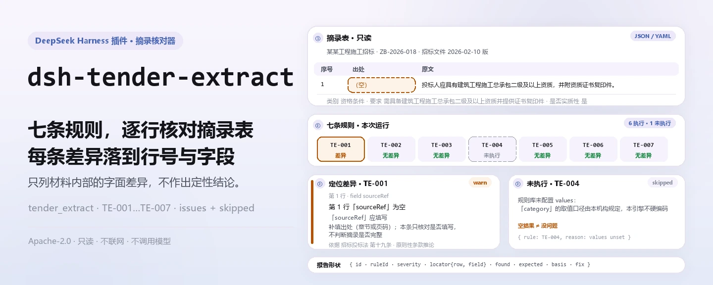
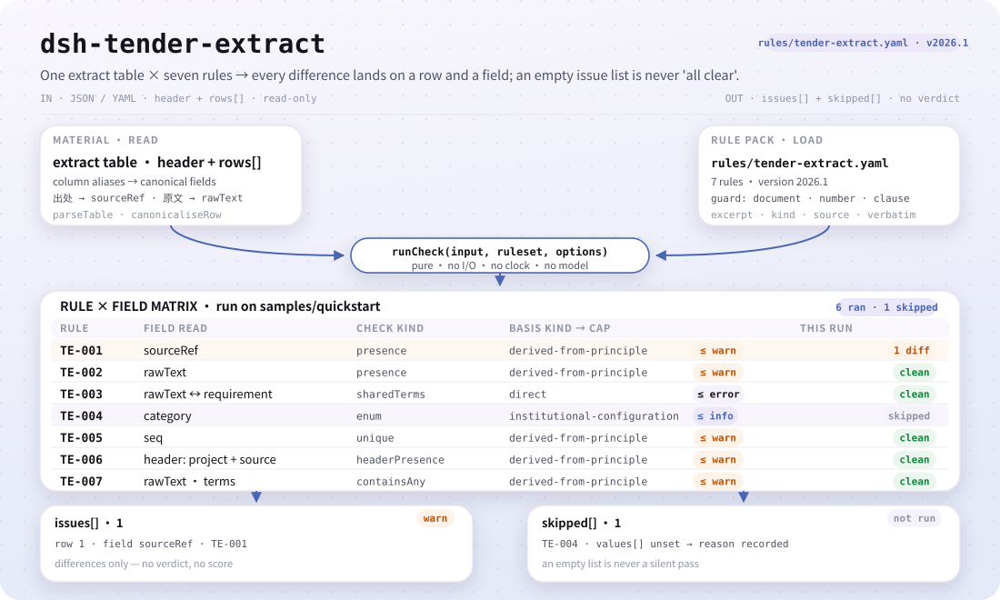
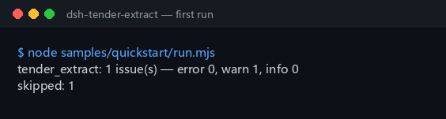

<div align="center">

<picture>
  <source media="(prefers-color-scheme: dark)" srcset="docs/assets/dsh-tender-extract-hero-zh-dark.webp">
  
</picture>

# dsh-tender-extract

**读一份招标条款摘录表，逐条告诉你哪一行、哪一栏、差什么——只列差异，不下结论。**

给招标代理与投标专员用的 DSH 检查器：七条规则核对出处、原文、提炼要求、类别、序号与模板占位符，每条发现都带行号、字段与修改提示，原件不动。

[安装](#三步上手) · [配置](#配置) · [FAQ](#faq) · [简体中文](README.md) · [English](README.en.md)

[](LICENSE)
[](#兼容性)
[](https://www.npmjs.com/package/dsh-tender-extract)
[](https://github.com/PerryLink/dsh-tender-extract/actions/workflows/ci.yml)
[](#兼容性)

[](https://github.com/PerryLink/dsh-tender-extract/stargazers)
[](https://www.npmjs.com/package/dsh-tender-extract)
[](https://dshfind.com/plugins/PerryLink/dsh-tender-extract?ref=badge)
[](https://securityscorecards.dev/viewer/?uri=github.com/PerryLink/dsh-tender-extract)
[](https://dsh.market/)
[](https://gitee.com/perrylink/dsh-tender-extract)

```sh
dsh plugin --profile <name> add dsh-tender-extract
```

</div>

<sub>社区插件，与 DeepSeek 官方无关。唯一仓库：<https://github.com/PerryLink/dsh-tender-extract>（Gitee 为镜像）。</sub>

## 它是什么

`dsh-tender-extract` 读取一份条款摘录表——材料表头加每条摘录一行——套用版本化规则库，只就这张表本身出报告：每行是否给出出处（`sourceRef`）、原文栏（`rawText`）是否填写、提炼的要求（`requirement`）与原文是否有共同词、所填类别是否在本机构清单内、摘录序号（`seq`）是否重复、表头是否写明项目与来源文件、原文栏是否残留模板占位符。条款类别取值出厂为空，未配置时 `TE-004` 在 `skipped` 中说明自己未执行，而不是静默通过。

给谁用：招标代理、投标专员；不用懂命令行。你交什么：这项核对用到的原始材料（表格、清单或文书），原件不会被修改；Excel 可先转成 JSON/YAML，对话里也能代转。它不做什么：不判合规、不认定责任、不替代审核人，只列材料内部能逐条指认的差异。

<picture>
  <source media="(prefers-color-scheme: dark)" srcset="docs/assets/dsh-tender-extract-flow-v5-dark.svg">
  
</picture>

## 三步上手

1. **安装**（三选一）：

   ```sh
   # npm 通道（已发布版本）
   dsh plugin --profile web add dsh-tender-extract
   # git 通道（最新 main）
   dsh plugin --profile web add github:PerryLink/dsh-tender-extract
   # tarball 通道：本仓库 pnpm pack 后
   dsh plugin --profile web add ./dsh-tender-extract-<version>.tgz
   ```

   npm 安装包自带 `lib/` 构建产物；从源码或 tarball 安装时，`main` 指向的 `lib/index.mjs` 必须已由 `pnpm run build` 生成。

2. **最小配置**（默认即可用；按需换规则库或停用规则）：

   ```yaml
   - insert:
       - id: dsh-tender-extract
         name: dsh-tender-extract
         config:
           rulesFile: rules/tender-extract.yaml
   ```

3. **验证已生效**：

   ```sh
   dsh --profile web --dump-config | grep 'dsh-tender-extract'
   node samples/quickstart/run.mjs --check
   ```

   ```
   tender_extract: 1 issue(s) — error 0, warn 1, info 0
   skipped: 1
   ```

   样例在 `samples/quickstart/input/`，期望输出在 `samples/quickstart/expected/result.json`；源码仓库需先 `pnpm run build`。真实首跑截图：

   

**卸载**：`dsh plugin --profile web remove dsh-tender-extract`（或从 profile patch 删掉该行）。

> 在 WorkBuddy / 扣子搜「投标合规核对包」（本检查是其中一项；上架以商城为准）；命令行入口就是上面的 `dsh plugin` 命令。

## 核心能力

`dsh-tender-extract` 只核对**摘录表自身的齐备与自洽**——它从不判断摘录是否摘全，也从不作合规结论。七条规则全部来自可替换的规则库：

| 规则 | 检查什么 | 严重级 | 依据类型 |
|---|---|---|---|
| `TE-001` | 每条摘录都给出出处（`sourceRef`） | `warn` | `derived-from-principle` |
| `TE-002` | 每条摘录都填写原文（`rawText`） | `warn` | `derived-from-principle` |
| `TE-003` | 提炼的要求与原文有共同词 | `warn` | `direct` |
| `TE-004` | 类别取自本机构清单（出厂关闭） | `info` | `institutional-configuration` |
| `TE-005` | 摘录序号唯一 | `warn` | `derived-from-principle` |
| `TE-006` | 表头写明项目与来源文件 | `warn` | `derived-from-principle` |
| `TE-007` | 原文栏无未替换的模板占位符 | `warn` | `derived-from-principle` |

- **逐条可定位的报告。** 每条发现都是 `{ id, ruleId, severity, locator, found, expected, fix }`：`locator` 指出行号与字段，`fix` 是一句可执行的修改提示。报告只列差异，不排名、不评分。
- **空结果不等于没问题。** 每条没能执行的检查都进 `skipped` 并写明原因；`TE-004` 在类别清单为空时就是这样自报，而不是悄悄通过。
- **规则库是数据。** 七条规则全在 `rules/tender-extract.yaml`，替换文件即可换规则集；加载期校验 `document` / `number` / `clause` / `excerpt` / `kind` / `source` 齐全，`excerpt` 必须是逐字引文。
- **只读、确定、无模型。** 不联网、不调模型、不写文件；全部计算是对输入字符串的墙上时钟运算，不做时区换算。

### 报告长什么样

下面是对 `TE-003` 夹具的真实输出，不是示意图。

**工具** `tender_extract`

**输入**

```json
{"rows":[{"原文":"甲乙丙丁戊己庚辛","要求":"一二三四五六七八"}]}
```

**输出**

```json
{
  "id": "dsh-tender-extract.TE-003.de09b5a6",
  "ruleId": "TE-003",
  "severity": "warn",
  "locator": {
    "row": 1,
    "field": "requirement"
  },
  "found": "第 1 行「requirement」与「rawText」没有共同词（共同词 0 个，配置下限 2 个）",
  "expected": "「requirement」应与「rawText」在字面上相关",
  "fix": "本条只提示两栏看不出关系、值得人工复核，不断言提炼有误；同义改写会拉低共同词数，可调整 minShared"
}
```

*Observed from `dsh-tender-extract/tests/fixtures/TE-003/TE-003-unsafe.json`*

## 配置

全部可调参数都在 `src/config.ts` 的 Schemastery schema 里，改 `cordis.yml` 即可生效，无需改代码；逐条规则的阈值在 `rules/` 的规则库文件里。按 id 覆盖会替换整行——请重述所有需要的键。

| 键 | 类型 | 默认值 | 说明 |
|---|---|---|---|
| `rulesFile` | string | `rules/tender-extract.yaml` | 规则库文件路径，相对插件包根目录 |
| `disabledRules` | string[] | `[]` | 要停用的规则 id 列表；每条都会出现在 `skipped` 中 |
| `onlyRules` | string[] | `[]` | 只执行这些规则 id；留空表示执行全部规则 |
| `skipNotes` | string | `""` | 附加到每条 `skipped` 说明后的备注 |
| `timeoutMs` | number | `120000` | 工具协作式超时预算（毫秒） |

规则级参数（写在规则库的 `params` 里）：

- `TE-003` `leftField` / `rightField` / `minShared`——两栏与共同词下限，出厂 `2`。设为 `1` 更宽松；这个下限是**本机构口径，不是标准数值**。
- `TE-004` `values`——你的条款类别，例如 `[资格条件, 技术规格, 商务条款, 评标办法, 合同条款]`；留空即不检查。
- `TE-007` `terms`——要匹配的占位符。`（略）` 刻意**不在**列表里：`……（略）` 是缩写长条款的正常写法，不当作占位符；若本机构模板确实用 `（略）` 占位整条，可自行把 `略` 加入 `terms`。

profile patch 覆盖示例：

```yaml
- insert:
    - id: dsh-tender-extract
      name: dsh-tender-extract
      config:
        disabledRules: [TE-007]
        skipNotes: 本项目暂不检查模板占位符
```

## 材料格式

工具接受 JSON 与 YAML：

```yaml
project: 某某工程施工招标
tenderNo: ZB-2026-018
source: 招标文件 2026-02-10 版
rows:
  - { 序号: '1', 出处: 第三章 第 3.2 条,
      原文: 投标人应具有建筑工程施工总承包二级及以上资质，并附资质证书复印件。,
      类别: 资格条件, 要求: 需具备建筑工程施工总承包二级及以上资质并提供证书复印件,
      是否实质性: 是, 响应: 需响应, 责任部门: 经营部 }
```

列名匹配忽略大小写、空格、下划线与连字符；报告沿用材料自己的列名，因此每条发现都指名它读的是哪一栏。

## FAQ

<details>
<summary>表里漏了一条条款，插件能发现吗？</summary>

不能。判断一条摘录是否*完整*，需要与整份招标文件比对，而**本插件只看得到摘录表**。`TE-001` 核对的是出处是否*记录在案*，从不是摘录是否详尽无遗；它也不作相反的声称。

</details>

<details>
<summary>原文栏已经填了——插件会确认它与招标文件逐字一致吗？</summary>

不会。`TE-002` 只核对 `rawText` 栏是否填写，不拿这段原文与招标文件比对；那需要持有人招标文件正本。

</details>

<details>
<summary>提炼的要求跟原文看着完全对不上，会被提示吗？</summary>

`TE-003` 看 `requirement` 与 `rawText` 是否有共同词——重叠的汉字二元组与完整拉丁词——两栏一个共同词都没有时提示该行。提炼本身就会改写措辞，所以这条提示的含义是「这两栏看不出关系，值得人工复核」，**不断言提炼有误**。它也抓不住「提炼错误但用词相似」的情况；`minShared` 出厂为 `2`，是本机构口径、不是标准数值。

</details>

<details>
<summary>我们还没定条款类别怎么分，类别栏会怎样？</summary>

取值出厂为空，未填写前 `TE-004` 在 `skipped` 中说明自己未执行，而不是静默通过。配置之后它只核对所填值是否在册，不判断该条款应归入哪一类。

</details>

<details>
<summary>数据存哪？会联网或调用模型吗？</summary>

都不会。插件读取你指定的材料，`writes` 为空、`network: false`，不调用模型；报告在内存里生成并返回，没有上传、没有外部服务。它也不修改原件。

</details>

## 安全边界

- **只核对摘录表本身。** 判断一条摘录是否摘全，需要与整份招标文件比对，而本插件只看得到摘录表；它不能证明漏摘，只暴露「清单内部说不通」的地方。
- **唯一的内容判断刻意做弱。** `TE-003` 只找原文与提炼要求的共同词，并且只在两者毫无共同之处时报告；一条发现意味着「这两栏看不出关系，值得人工复核」，绝不意味着「提炼错了」。
- **引文纪律。** 规则库的每条 `excerpt` 都是逐字引文（2026-10-07 已逐条替换，核验记录在 `rules/evidence/`）；依据强度如实写入 `kind`：`derived-from-principle` 封顶 `warn`，`institutional-configuration` 封顶 `info`，只有 `TE-003` 是 `direct`。夸大依据的规则库会在加载期失败，而不会产出一份看起来很有底气的报告。
- **空清单自报。** 条款类别取值出厂为空；未配置时 `TE-004` 进 `skipped`，不静默放过。
- **不做定性结论。** 报告不判合规、不认定责任、不判断提炼正确性；措辞守卫（wording guard）会拦下此类表述，报告固定携带免责声明。
- **只读与零外联。** 读取用户指定的材料，`writes` 为空、`network: false`；不调用模型，也不向任何服务发送材料内容。
- **引文守卫有客观上限。** 加载期守卫只能要求 `excerpt` 至少八个字符，无法分辨引文与描述；因此规则库还依赖包头的引用说明、每条规则的 `note`，以及一个断言每条 `excerpt` 都如实交代核验状态的测试。

### 依据的标准

| 文件 | 文号 | 引用它的规则 |
|---|---|---|
| 《中华人民共和国招标投标法》 | 1999年8月30日通过，2017年12月27日修正（全国人大常委会《关于修改〈中华人民共和国招标投标法〉、〈中华人民共和国计量法〉的决定》），本法自2000年1月1日起施行 | TE-001, TE-002, TE-003, TE-004, TE-005, TE-006, TE-007 |

**边界：** 本插件核对一份**招标文件条款摘录表**，范围限于核对表可以据以要求的事项——每条摘录是否给出出处、条款原文是否记录、提炼出的要求与该原文是否具有某种字面关联、条款类别是否取自你配置的取值口径、序号是否唯一、以及是否残留占位符。

## 已知限制

- **不能证明漏摘。** 完整性只能与整份招标文件比对得出，本插件看不到全文；`TE-001` 只核对出处是否填写。
- **`TE-002` 不比对原文。** 只核对原文栏是否填写；要确认与招标文件逐字一致，需要持有人招标文件正本。
- **`TE-003` 的三种局限。** 同义改写会拉低共同词数而触发提示；「提炼错误但用词相似」抓不住；`minShared` 出厂 `2` 是本机构口径、不是标准数值。
- **`TE-005` 只查重复。** 比较 `seq` 时忽略空白字符差异；序号编得合不合理，它不作判断。
- **`TE-007` 只看词表。** 只匹配出厂词表（`【`、`】`、`{{`、`}}`、`XXX`、`xxx`、`待填`、`待补充`、`TBD`、`todo`、`示例`），看不到词表以外的占位写法；`（略）` 刻意不在列表里，因为 `……（略）` 是省略长条款的正常写法。
- **六条依据未升到 `direct`。** `TE-001` / `TE-002` / `TE-005` / `TE-006` / `TE-007` 的依据是原则性条款，`TE-004` 是本机构口径，严重级分别封顶 `warn` / `info`；只有 `TE-003` 是 `direct`。
- **静态检查器的已知上游问题。** `check` 可能把 `manifest-peers` 报成失败——它比对的是一份早于 0.2 世代的硬编码 peer 范围；安装期 peer 校验以运行时为准。

## 兼容性

| 项目 | 状态 |
|---|---|
| Harness | 对等版本范围 `>=0.1.2-rc.1 <0.2.0 \|\| >=0.2.0-0 <0.3.0`——已实测同时接受 `0.2.0-rc.2` 与 `0.2.1-rc.2`。**已声明 `engines.dsh`**：`>=0.2.1-0 <0.3.0`，0.2.1 起由宿主单独裁决 |
| Node | `^22.19.0 \|\| >=24.0.0` |
| 平台 | 全平台（纯 ESM；无原生代码、无联网、不调用模型） |
| 工具模式 | `native` / `ptc` 均可；批量校验整个目录时建议 `ptc`，schema 成本只付一次 |

## 生态与质量

- [Gitee 镜像](https://gitee.com/perrylink/dsh-tender-extract)（同步镜像，以 GitHub 为准）
- [dshfind 插件页](https://dshfind.com/plugins/PerryLink/dsh-tender-extract)（安装量与排名）
- [OpenSSF Scorecard 报告](https://securityscorecards.dev/viewer/?uri=github.com/PerryLink/dsh-tender-extract)（由 [.github/workflows/scorecard.yml](.github/workflows/scorecard.yml) 驱动）
- [DSH Market](https://dsh.market/)（已上架）
- [按材料选核查器](https://perrylink.github.io/zh/checkers/choose/)（PerryLink 家族索引）

## 故障排查

- **插件装上了但工具不出现**：确认 `main` 指向 `lib/index.mjs` 且 `pnpm run build` 已生成该文件；`main` 写错会让加载器静默跳过该条目。
- **`dsh plugin add` 报版本不兼容**：peer 范围覆盖 `0.1.x` 与 `0.2.x`；若运行时在其之外，可显式豁免：`dsh plugin --profile <name> allow-version dsh-tender-extract@0.2.12 --dsh-version <runtime> --accept-risk`。
- **某条规则没有执行**：查看 `skipped` 数组，其中写明了规则 id 与原因。
- **`check` 报 `manifest-peers` 失败**：静态检查器比对的是一份早于 0.2 世代的硬编码 peer 范围；安装期 peer 校验以运行时为准。这是 `dsh-plugin-dev` 的已知上游问题。
- **报告把某条规则标成推定依据**：`derived-from-principle` / `institutional-configuration` 表示依据未逐条坐实；把它当核验缺口，而不是合规证明。复核记录在 `rules/evidence/`。
- **时间看起来偏移**：全部计算都是对输入字符串做墙上时钟运算，不做时区换算。

## 开发

```sh
pnpm install
pnpm run typecheck
pnpm test
pnpm run build
pnpm run verify:self-contained
pnpm run check:lockfile
pnpm run check:citations
pnpm run check:readmes
pnpm pack
node ../scripts/sync-shared.mjs dsh-tender-extract
```

`pnpm run build`（tsdown）产出 `lib/index.mjs` 与 `lib/index.d.mts`；`node ../scripts/sync-shared.mjs dsh-tender-extract` 把 `../_shared` 的共享件同步进 `src/shared/`，每次改动共享件后都要重跑。

| 路径 | 内容 |
|---|---|
| `src/index.ts` | 函数插件契约：注册 `tender_extract` 工具并解析随包规则库 |
| `src/config.ts` | Schemastery schema；全部可调项都在这里 |
| `src/check.ts` | 纯检查核心 `(input, ruleset, options) => Report`，无 I/O、无时钟、无模型 |
| `src/parse.ts` | JSON / YAML 材料读取层 |
| `src/view.ts` | 报告面向模型的投影；`index.ts` 的 `output.schema` 与之一致 |
| `src/shared/` | 共享件（规则库加载、报告形状、日历运算、措辞守卫），复制进来而非依赖 |
| `rules/tender-extract.yaml` | 规则库，7 条规则 |
| `rules/evidence/` | 每条引文的条款核验记录 |
| `tests/` | vitest；每条规则一对合规 / 违规夹具 |
| `samples/quickstart/` | 一分钟试跑样例与期望输出 |
| `docs/assets/` | README 配图 |
| `scripts/` | 校验门、条款引用检查与配图脚本 |

README 配图由 [`scripts/gen-readme-assets.py`](scripts/gen-readme-assets.py) 程序化生成（Python + Pillow 生成深浅双版 hero WebP，手写深浅双版结构 SVG），可重复执行：`python scripts/gen-readme-assets.py`。

Topics：`dsh`, `dsh-plugin`, `deepseek-harness`, `deepseek`, `cordis`, `tender`, `extract`

## 家族与致谢

本项目是 [PerryLink](https://github.com/PerryLink) 维护的 DeepSeek Harness 插件家族成员（全部 Apache-2.0）。如果这个插件帮到了你，**给个 star**——它不解锁任何功能，但会让下一个人更容易找到它。

- [@PerryLink](https://github.com/PerryLink) —— 创建者与维护者：规则库设计、检查引擎、条款核验记录与五语文档。

<details>
<summary>展开全部插件</summary>

| 插件 | 状态 |
|---|---|
| **[dsh-aqua-input-check](https://github.com/PerryLink/dsh-aqua-input-check)** |  |
| **[dsh-archive-check](https://github.com/PerryLink/dsh-archive-check)** |  |
| **[dsh-auto-review](https://github.com/PerryLink/dsh-auto-review)** |  |
| **[dsh-autotier](https://github.com/PerryLink/dsh-autotier)** | 🧊 已冻结 — 见仓库 README |
| **[dsh-bid-ca-precheck](https://github.com/PerryLink/dsh-bid-ca-precheck)** |  |
| **[dsh-bid-qual-check](https://github.com/PerryLink/dsh-bid-qual-check)** |  |
| **[dsh-cert-mcp](https://github.com/PerryLink/dsh-cert-mcp)** | 🧊 已冻结 — 见仓库 README |
| **[dsh-checkpoint-rewind](https://github.com/PerryLink/dsh-checkpoint-rewind)** |  |
| **[dsh-click](https://github.com/PerryLink/dsh-click)** |  |
| **[dsh-composer-history](https://github.com/PerryLink/dsh-composer-history)** |  |
| **[dsh-contract-stance](https://github.com/PerryLink/dsh-contract-stance)** |  |
| **[dsh-customs-doc-check](https://github.com/PerryLink/dsh-customs-doc-check)** |  |
| **[dsh-data-quality](https://github.com/PerryLink/dsh-data-quality)** | 🧊 已冻结 — 见仓库 README |
| **[dsh-demurrage-ledger](https://github.com/PerryLink/dsh-demurrage-ledger)** |  |
| **[dsh-doublecheck](https://github.com/PerryLink/dsh-doublecheck)** |  |
| **[dsh-drill-script-check](https://github.com/PerryLink/dsh-drill-script-check)** |  |
| **[dsh-eia-guide-check](https://github.com/PerryLink/dsh-eia-guide-check)** |  |
| **[dsh-emergency-plan](https://github.com/PerryLink/dsh-emergency-plan)** |  |
| **[dsh-essay-rubric-check](https://github.com/PerryLink/dsh-essay-rubric-check)** |  |
| **[dsh-evidence-check](https://github.com/PerryLink/dsh-evidence-check)** |  |
| **[dsh-export-ctl-check](https://github.com/PerryLink/dsh-export-ctl-check)** |  |
| **[dsh-fast](https://github.com/PerryLink/dsh-fast)** |  |
| **[dsh-fmea-table-check](https://github.com/PerryLink/dsh-fmea-table-check)** |  |
| **[dsh-forecast-penalty](https://github.com/PerryLink/dsh-forecast-penalty)** |  |
| **[dsh-fund-research](https://github.com/PerryLink/dsh-fund-research)** |  |
| **[dsh-github](https://github.com/PerryLink/dsh-github)** |  |
| **[dsh-gongwen-flow-check](https://github.com/PerryLink/dsh-gongwen-flow-check)** |  |
| **[dsh-gongwen-word-check](https://github.com/PerryLink/dsh-gongwen-word-check)** |  |
| **[dsh-guard-plan-qc](https://github.com/PerryLink/dsh-guard-plan-qc)** |  |
| **[dsh-hazchem-check](https://github.com/PerryLink/dsh-hazchem-check)** |  |
| **[dsh-hazplan-check](https://github.com/PerryLink/dsh-hazplan-check)** |  |
| **[dsh-hidden-risk-map](https://github.com/PerryLink/dsh-hidden-risk-map)** |  |
| **[dsh-hs-classify](https://github.com/PerryLink/dsh-hs-classify)** |  |
| **[dsh-icd-rule-check](https://github.com/PerryLink/dsh-icd-rule-check)** |  |
| **[dsh-industry-research](https://github.com/PerryLink/dsh-industry-research)** |  |
| **[dsh-lawcite-adapter](https://github.com/PerryLink/dsh-lawcite-adapter)** |  |
| **[dsh-laya](https://github.com/PerryLink/dsh-laya)** |  |
| **[dsh-lc-doc-check](https://github.com/PerryLink/dsh-lc-doc-check)** |  |
| **[dsh-learning-gap-check](https://github.com/PerryLink/dsh-learning-gap-check)** |  |
| **[dsh-library](https://github.com/PerryLink/dsh-library)** |  |
| **[dsh-local-ai](https://github.com/PerryLink/dsh-local-ai)** |  |
| **[dsh-lsp-actions](https://github.com/PerryLink/dsh-lsp-actions)** |  |
| **[dsh-mask](https://github.com/PerryLink/dsh-mask)** |  |
| **[dsh-mcp-panel](https://github.com/PerryLink/dsh-mcp-panel)** |  |
| **[dsh-medrec-qc](https://github.com/PerryLink/dsh-medrec-qc)** |  |
| **[dsh-memento](https://github.com/PerryLink/dsh-memento)** | 🧊 已冻结 — 见仓库 README |
| **[dsh-nsfc-form-check](https://github.com/PerryLink/dsh-nsfc-form-check)** |  |
| **[dsh-nurse-record-check](https://github.com/PerryLink/dsh-nurse-record-check)** |  |
| **[dsh-observe](https://github.com/PerryLink/dsh-observe)** |  |
| **[dsh-origin-rvc-check](https://github.com/PerryLink/dsh-origin-rvc-check)** |  |
| **[dsh-ota-review-check](https://github.com/PerryLink/dsh-ota-review-check)** |  |
| **[dsh-output-styles](https://github.com/PerryLink/dsh-output-styles)** |  |
| **[dsh-paper-doc-adapter](https://github.com/PerryLink/dsh-paper-doc-adapter)** |  |
| **[dsh-permission-rules](https://github.com/PerryLink/dsh-permission-rules)** |  |
| **[dsh-permit-report-check](https://github.com/PerryLink/dsh-permit-report-check)** |  |
| **[dsh-pipeline-check](https://github.com/PerryLink/dsh-pipeline-check)** |  |
| **[dsh-pleading-draft](https://github.com/PerryLink/dsh-pleading-draft)** |  |
| **[dsh-plugin-doctor](https://github.com/PerryLink/dsh-plugin-doctor)** | 🚫 已退役（仓库已归档） |
| **[dsh-plugin-guide](https://github.com/PerryLink/dsh-plugin-guide)** |  |
| **[dsh-plugin-kit](https://github.com/PerryLink/dsh-plugin-kit)** | 🚫 已退役（仓库已归档） |
| **[dsh-plugin-upgrade](https://github.com/PerryLink/dsh-plugin-upgrade)** | 🚫 已退役（仓库已归档） |
| **[dsh-policy-brief-draft](https://github.com/PerryLink/dsh-policy-brief-draft)** |  |
| **[dsh-power-loss-split](https://github.com/PerryLink/dsh-power-loss-split)** |  |
| **[dsh-power-ticket-check](https://github.com/PerryLink/dsh-power-ticket-check)** |  |
| **[dsh-ppap-check](https://github.com/PerryLink/dsh-ppap-check)** |  |
| **[dsh-protest-deadline](https://github.com/PerryLink/dsh-protest-deadline)** |  |
| **[dsh-railway-window](https://github.com/PerryLink/dsh-railway-window)** |  |
| **[dsh-repair-order-qc](https://github.com/PerryLink/dsh-repair-order-qc)** |  |
| **[dsh-research-report](https://github.com/PerryLink/dsh-research-report)** |  |
| **[dsh-review-reply-check](https://github.com/PerryLink/dsh-review-reply-check)** |  |
| **[dsh-rulefile-check](https://github.com/PerryLink/dsh-rulefile-check)** |  |
| **[dsh-safety-brief-check](https://github.com/PerryLink/dsh-safety-brief-check)** |  |
| **[dsh-score](https://github.com/PerryLink/dsh-score)** | 🧊 已冻结 — 见仓库 README |
| **[dsh-session-sync](https://github.com/PerryLink/dsh-session-sync)** |  |
| **[dsh-site-log-check](https://github.com/PerryLink/dsh-site-log-check)** |  |
| **[dsh-skill-pack-security](https://github.com/PerryLink/dsh-skill-pack-security)** |  |
| **[dsh-soe-decision-check](https://github.com/PerryLink/dsh-soe-decision-check)** |  |
| **[dsh-soilwater-check](https://github.com/PerryLink/dsh-soilwater-check)** |  |
| **[dsh-sop-sync-check](https://github.com/PerryLink/dsh-sop-sync-check)** |  |
| **[dsh-spc-gbt-adapter](https://github.com/PerryLink/dsh-spc-gbt-adapter)** |  |
| **[dsh-talk](https://github.com/PerryLink/dsh-talk)** |  |
| **[dsh-tender-extract](https://github.com/PerryLink/dsh-tender-extract)** |  |
| **[dsh-tender-matrix](https://github.com/PerryLink/dsh-tender-matrix)** |  |
| **[dsh-test-drive](https://github.com/PerryLink/dsh-test-drive)** |  |
| **[dsh-ticktick](https://github.com/PerryLink/dsh-ticktick)** | 🚫 已退役（仓库已归档） |
| **[dsh-translate](https://github.com/PerryLink/dsh-translate)** |  |
| **[dsh-warranty-calc](https://github.com/PerryLink/dsh-warranty-calc)** |  |
| **[dsh-budget](https://github.com/PerryLink/dsh-budget)** | 🧊 已冻结 — 见仓库 README |
| **[dsh-claude-move](https://github.com/PerryLink/dsh-claude-move)** | 🧊 已冻结 — 见仓库 README |
| **[dsh-defend](https://github.com/PerryLink/dsh-defend)** | 🧊 已冻结 — 见仓库 README |
| **[dsh-draw](https://github.com/PerryLink/dsh-draw)** | 🧊 已冻结 — 见仓库 README |
| **[dsh-reach](https://github.com/PerryLink/dsh-reach)** | 🧊 已冻结 — 见仓库 README |
| **[dsh-background-agents](https://github.com/PerryLink/dsh-background-agents)** | 🚫 已退役（仓库已归档） |
| **[dsh-session-pin](https://github.com/PerryLink/dsh-session-pin)** | 🚫 已退役（仓库已归档） |
| **[dsh-team-rooms](https://github.com/PerryLink/dsh-team-rooms)** | 🚫 已退役（仓库已归档） |

</details>

## License

[LICENSE](LICENSE)（Apache License 2.0）© 2026 dsh-tender-extract contributors

<p align="center"><sub>Apache-2.0 · 社区插件，与 DeepSeek 无关。</sub></p>
