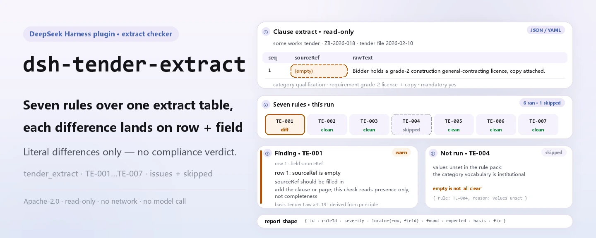
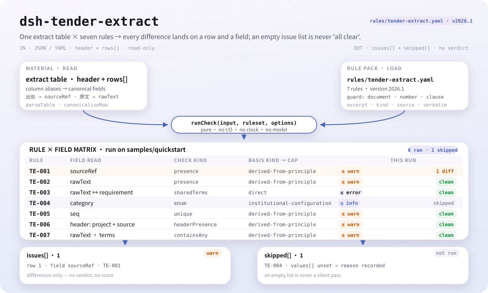
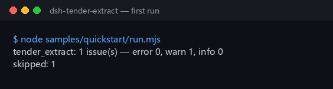

<div align="center">

<picture>
  <source media="(prefers-color-scheme: dark)" srcset="docs/assets/dsh-tender-extract-hero-en-dark.webp">
  
</picture>

# dsh-tender-extract

**Leia uma tabela de extratos de cláusulas do caderno de encargos e receba, linha a linha, o que está errado e onde — apenas diferenças, sem veredicto.**

Um verificador DSH para agentes de licitação e licitantes: sete regras cobrem origem, texto original, exigência destilada, categoria, sequência e marcadores de modelo, e cada achado indica a linha, o campo e a correção.

[Instalação](#instalação-em-três-passos) · [Configuração](#configuração) · [FAQ](#faq) · [简体中文](README.md) · [English](README.en.md) · [Español](README.es.md) · [Português](README.pt.md) · [हिन्दी](README.hi.md)

[](LICENSE)
[](#compatibilidade)
[](https://www.npmjs.com/package/dsh-tender-extract)
[](https://github.com/PerryLink/dsh-tender-extract/actions/workflows/ci.yml)
[](#compatibilidade)

[](https://github.com/PerryLink/dsh-tender-extract/stargazers)
[](https://www.npmjs.com/package/dsh-tender-extract)
[](https://dshfind.com/plugins/PerryLink/dsh-tender-extract?ref=badge)
[](https://securityscorecards.dev/viewer/?uri=github.com/PerryLink/dsh-tender-extract)
[](https://dsh.market/)
[](https://gitee.com/perrylink/dsh-tender-extract)

```sh
dsh plugin --profile <name> add dsh-tender-extract
```

</div>

<sub>Complemento comunitário, não afiliado à DeepSeek. Repositório canônico: <https://github.com/PerryLink/dsh-tender-extract> (o Gitee é um espelho).</sub>

## O que é

`dsh-tender-extract` lê uma tabela de extratos de cláusulas — o cabeçalho do processo mais uma linha por extrato —, aplica um pacote de regras versionado e devolve um relatório sobre essa tabela e só sobre ela: que cada linha indique a sua origem (`sourceRef`), que a coluna do texto original (`rawText`) esteja preenchida, que a exigência destilada (`requirement`) partilhe algum termo com esse texto, que a categoria registada conste da lista da sua instituição, que nenhum número de extrato (`seq`) se repita, que o cabeçalho nomeie o projeto e o documento de origem, e que não reste nenhum marcador de modelo no texto original. O vocabulário de categorias de cláusula vem vazio e, sem nada configurado, `TE-004` declara-se em `skipped` em vez de passar em silêncio.

Para quem: agentes de licitação e licitantes; não é preciso saber usar a linha de comandos. O que entrega: o material de origem sobre o qual a verificação trabalha (uma tabela, um registo ou um documento); o original nunca é alterado, e o Excel pode ser convertido antes para JSON/YAML — no chat, se a plataforma o permitir. O que não faz: não emite veredicto de conformidade, não determina responsabilidades e não substitui o revisor; apenas enumera diferenças.

<picture>
  <source media="(prefers-color-scheme: dark)" srcset="docs/assets/dsh-tender-extract-flow-v5-dark.svg">
  
</picture>

## Instalação em três passos

1. **Instalar** (escolha um canal):

   ```sh
   # canal npm (versões publicadas)
   dsh plugin --profile web add dsh-tender-extract
   # canal git (última main)
   dsh plugin --profile web add github:PerryLink/dsh-tender-extract
   # canal tarball: após pnpm pack neste repositório
   dsh plugin --profile web add ./dsh-tender-extract-<version>.tgz
   ```

   O pacote npm inclui `lib/` já construído; ao instalar a partir de git ou de um tarball, `lib/index.mjs` (o destino de `main`) tem de ter sido gerado por `pnpm run build`.

2. **Configuração mínima** (os valores padrão já funcionam; troque o pacote de regras ou desative regras conforme necessário):

   ```yaml
   - insert:
       - id: dsh-tender-extract
         name: dsh-tender-extract
         config:
           rulesFile: rules/tender-extract.yaml
   ```

3. **Confirmar que montou**:

   ```sh
   dsh --profile web --dump-config | grep 'dsh-tender-extract'
   node samples/quickstart/run.mjs --check
   ```

   ```
   tender_extract: 1 issue(s) — error 0, warn 1, info 0
   skipped: 1
   ```

   As amostras estão em `samples/quickstart/input/` e a saída esperada em `samples/quickstart/expected/result.json`; um checkout do código-fonte precisa de `pnpm run build` antes. Captura real da primeira execução:

   

**Desinstalar**: `dsh plugin --profile web remove dsh-tender-extract` (ou remova a linha do patch do perfil).

> Procure «Tender Compliance Suite» no WorkBuddy / Coze (esta verificação é uma das suas partes; disponibilidade conforme catálogo); a entrada por linha de comandos é o comando `dsh plugin` acima.

## Capacidades principais

`dsh-tender-extract` verifica a **integridade e coerência interna da própria tabela de extratos** — nunca julga se um extrato está completo e nunca emite um veredicto de conformidade. As sete regras vêm de um pacote de regras substituível:

| Regra | O que verifica | Gravidade | Tipo de base |
|---|---|---|---|
| `TE-001` | cada extrato indica a sua origem (`sourceRef`) | `warn` | `derived-from-principle` |
| `TE-002` | cada extrato regista o texto original (`rawText`) | `warn` | `derived-from-principle` |
| `TE-003` | a exigência partilha termos com o texto original | `warn` | `direct` |
| `TE-004` | a categoria vem do seu vocabulário (desativada de fábrica) | `info` | `institutional-configuration` |
| `TE-005` | os números de extrato são únicos | `warn` | `derived-from-principle` |
| `TE-006` | a tabela nomeia o projeto e o documento de origem | `warn` | `derived-from-principle` |
| `TE-007` | o texto original não conserva marcadores de modelo | `warn` | `derived-from-principle` |

- **Um relatório localizável.** Cada achado é `{ id, ruleId, severity, locator, found, expected, fix }`: `locator` indica a linha e o campo, e `fix` é uma frase acionável. O relatório apenas enumera diferenças: sem ranking nem pontuação.
- **Um resultado vazio não é um certificado.** Toda a verificação que não pôde ser executada aparece em `skipped` com o motivo; é assim que `TE-004` se declara enquanto o vocabulário de categorias está vazio, em vez de passar em silêncio.
- **O pacote de regras é dado.** As sete regras vivem em `rules/tender-extract.yaml`; substituir o ficheiro troca o conjunto de regras. O carregamento valida que `document` / `number` / `clause` / `excerpt` / `kind` / `source` estão presentes e que `excerpt` é uma citação literal.
- **Só leitura, determinístico, sem modelo.** Sem rede, sem chamada ao modelo e sem escrita de ficheiros; toda a aritmética é de hora local sobre as cadeias de entrada, sem conversão de fuso horário.

### Como é o relatório

Abaixo está a saída real contra o fixture `TE-003`, não uma ilustração.

**Ferramenta** `tender_extract`

**Entrada**

```json
{"rows":[{"原文":"甲乙丙丁戊己庚辛","要求":"一二三四五六七八"}]}
```

**Saída**

```json
{
  "id": "dsh-tender-extract.TE-003.de09b5a6",
  "ruleId": "TE-003",
  "severity": "warn",
  "locator": {
    "row": 1,
    "field": "requirement"
  },
  "found": "第 1 行「requirement」与「rawText」没有共同词（共同词 0 个，配置下限 2 个）",
  "expected": "「requirement」应与「rawText」在字面上相关",
  "fix": "本条只提示两栏看不出关系、值得人工复核，不断言提炼有误；同义改写会拉低共同词数，可调整 minShared"
}
```

*Observado em `dsh-tender-extract/tests/fixtures/TE-003/TE-003-unsafe.json`*

## Configuração

Todos os parâmetros ajustáveis são campos Schemastery `Config` em `src/config.ts` e mudam-se pelo `cordis.yml` sem tocar no código; os limites por regra ficam no pacote de regras sob `rules/`. Uma substituição dirigida por id substitui a linha inteira: repita todas as chaves de que precisa.

| Chave | Tipo | Padrão | Descrição |
|---|---|---|---|
| `rulesFile` | string | `rules/tender-extract.yaml` | Caminho do pacote de regras, relativo à raiz do pacote |
| `disabledRules` | string[] | `[]` | Ids de regras a desativar; cada uma aparece em `skipped` |
| `onlyRules` | string[] | `[]` | Executar apenas estas regras; vazio executa todas |
| `skipNotes` | string | `""` | Nota acrescentada a cada motivo de `skipped` |
| `timeoutMs` | number | `120000` | Orçamento de tempo limite cooperativo da ferramenta |

Parâmetros por regra (dentro de `params` do pacote de regras):

- `TE-003` `leftField` / `rightField` / `minShared`: as duas colunas e o mínimo de termos partilhados, `2` por padrão. Defina `1` para ser mais permissivo; o mínimo é **uma convenção local, não um valor normativo**.
- `TE-004` `values`: as suas categorias de cláusula, p. ex. `[qualification, technical-specification, commercial-terms, evaluation-method, contract-terms]`; vazio significa que não se verifica.
- `TE-007` `terms`: os marcadores a procurar. O marcador de passagem omitida está deliberadamente **ausente**: é uma forma normal de abreviar uma cláusula longa, por isso não é tratado como marcador. Se o seu modelo realmente o usa para substituir uma cláusula inteira, acrescente-o você mesmo a `terms`.

Exemplo de substituição no patch do perfil:

```yaml
- insert:
    - id: dsh-tender-extract
      name: dsh-tender-extract
      config:
        disabledRules: [TE-007]
        skipNotes: Os marcadores de modelo ficam fora do âmbito deste projeto
```

## Formato do material

A ferramenta aceita JSON ou YAML:

```yaml
project: 某某工程施工招标
tenderNo: ZB-2026-018
source: 招标文件 2026-02-10 版
rows:
  - { 序号: '1', 出处: 第三章 第 3.2 条,
      原文: 投标人应具有建筑工程施工总承包二级及以上资质，并附资质证书复印件。,
      类别: 资格条件, 要求: 需具备建筑工程施工总承包二级及以上资质并提供证书复印件,
      是否实质性: 是, 响应: 需响应, 责任部门: 经营部 }
```

Os nomes das colunas são comparados sem distinguir maiúsculas de minúsculas e ignorando espaços, sublinhados e hífenes; os nomes próprios da tabela são mantidos, por isso cada achado nomeia a coluna que leu.

## FAQ

<details>
<summary>Falta uma cláusula na minha tabela. O plugin deteta isso?</summary>

Não. Decidir se um extrato está *completo* exige compará-lo com o caderno de encargos inteiro, e **este plugin só vê a tabela de extratos**. `TE-001` verifica que a origem está *registada*, nunca que o extrato seja exaustivo, e não afirma o contrário.

</details>

<details>
<summary>A coluna do texto original está preenchida — o plugin confirma que coincide palavra a palavra com o caderno de encargos?</summary>

Não. `TE-002` verifica apenas que a coluna `rawText` está preenchida; não compara esse texto com o caderno de encargos, o que exige ter o documento original em mãos.

</details>

<details>
<summary>A exigência destilada parece vir de outro sítio completamente. Isso será assinalado?</summary>

`TE-003` procura termos partilhados entre `requirement` e `rawText` — bigramas Han sobrepostos e palavras latinas inteiras — e reporta a linha quando não partilham nada. Parafrasear altera legitimamente as palavras, por isso um achado significa que as duas colunas parecem não ter relação e merecem uma vista humana, nunca que a destilação está errada. Também não deteta uma destilação errada que partilhe vocabulário, e o limiar `minShared` de `2` é uma convenção local, não um valor normativo.

</details>

<details>
<summary>Ainda não decidimos como classificar as nossas cláusulas. O que acontece à coluna da categoria?</summary>

Os valores vêm vazios, por isso `TE-004` declara-se em `skipped` em vez de passar em silêncio até os preencher. Depois de configurado, verifica apenas que o valor registado consta da sua lista; não decide a que categoria pertence uma cláusula.

</details>

<details>
<summary>Onde ficam os dados? Liga-se à rede ou a um modelo?</summary>

A nenhum dos dois. O plugin lê o material que o utilizador indica, com `writes` vazio e `network: false`, e nunca chama um modelo; o relatório é gerado em memória e devolvido — sem upload nem serviço externo — e o ficheiro original não é alterado.

</details>

## Limites de segurança

- **A tabela de extratos é toda a entrada.** Decidir se um extrato está completo exige o caderno de encargos inteiro, e este plugin só vê a tabela; não pode provar que falta uma cláusula, apenas expõe os pontos em que o registo não fecha.
- **O único juízo de conteúdo é deliberadamente fraco.** `TE-003` procura apenas termos partilhados entre o texto original e a exigência destilada, e reporta só quando não partilham nada; um achado significa «estas duas colunas parecem não ter relação, merecem uma vista humana», nunca «a destilação está errada».
- **Disciplina de citações.** Cada `excerpt` do pacote de regras é uma citação literal (substituída regra a regra em 2026-10-07; o registo de verificação está em `rules/evidence/`), e a força da base é declarada em `kind`: `derived-from-principle` com teto `warn`, `institutional-configuration` com teto `info`, e só `TE-003` é `direct`. Um pacote que exagere a sua base falha ao carregar em vez de produzir um relatório que pareça sólido.
- **Uma lista vazia declara-se.** O vocabulário de categorias vem vazio; sem nada configurado, `TE-004` fica em `skipped` em vez de passar em silêncio.
- **Sem linguagem que adjudique.** O relatório não se pronuncia sobre conformidade, responsabilidade ou correção; um guarda de redação bloqueia essas afirmações e o relatório leva sempre o aviso legal.
- **Só leitura e sem ligação.** Lê o material que o utilizador indica, com `writes` vazio e `network: false`; nenhuma chamada ao modelo e nenhum conteúdo enviado a qualquer serviço.
- **O guarda de citações tem um limite objetivo.** O guarda de carregamento pode exigir que `excerpt` tenha pelo menos oito caracteres, mas não distingue uma citação de uma descrição; por isso o pacote também se apoia no cabeçalho, no `note` de cada regra e num teste que verifica que cada `excerpt` declara o seu estado de verificação com verdade.

### Normas que segue

| Documento | Número | Regras que o citam |
|---|---|---|
| 《中华人民共和国招标投标法》 | 1999年8月30日通过，2017年12月27日修正（全国人大常委会《关于修改〈中华人民共和国招标投标法〉、〈中华人民共和国计量法〉的决定》），本法自2000年1月1日起施行 | TE-001, TE-002, TE-003, TE-004, TE-005, TE-006, TE-007 |

**Limite:** este plugin verifica uma **tabela de extratos de cláusulas do caderno de encargos** no que uma lista de verificação pode exigir — que cada extrato dê a sua origem, que o texto original da cláusula fique registado, que a exigência destilada guarde alguma relação lexical com esse texto, que a categoria venha do seu vocabulário, que os números sejam únicos e que não reste nenhum marcador.

## Limitações conhecidas

- **Não pode provar que falta uma cláusula.** A exaustividade só se julga contra o caderno de encargos inteiro, que este plugin nunca vê; `TE-001` apenas verifica que a origem está registada.
- **`TE-002` não compara o texto.** Apenas verifica que a coluna do texto original está preenchida; confirmar uma coincidência palavra a palavra exige o caderno de encargos em mãos.
- **Três limites de `TE-003`.** A paráfrase reduz o número de termos partilhados e pode provocar um aviso; uma destilação errada que conserve o vocabulário não é detetada; o limiar `minShared` de `2` é uma convenção local, não um valor normativo.
- **`TE-005` só encontra repetições.** Compara os valores de `seq` ignorando diferenças de espaçamento; não julga se a numeração é sensata no resto.
- **`TE-007` só vê a sua lista de termos.** Coincide com a lista de fábrica e não vê estilos de marcador fora dela; o marcador de passagem omitida está deliberadamente ausente porque é uma forma normal de abreviar uma cláusula longa.
- **Seis regras não são `direct`.** `TE-001` / `TE-002` / `TE-005` / `TE-006` / `TE-007` apoiam-se em cláusulas de princípio e `TE-004` em configuração local, por isso a gravidade fica limitada a `warn` / `info`; só `TE-003` é `direct`.
- **Problema conhecido do verificador estático.** `check` pode reportar `manifest-peers` como falha porque compara com um intervalo de peers codificado anterior à linha 0.2; o runtime aplica a compatibilidade de peers na instalação.

A lista de termos de fábrica do `TE-007`, literal de `rules/tender-extract.yaml`:

```text
【  】  {{  }}  XXX  xxx  待填  待补充  TBD  todo  示例
Ausente a propósito: （略） — «……（略）» é uma forma normal de abreviar uma cláusula longa.
```

## Compatibilidade

| Superfície | Estado |
|---|---|
| Harness | Faixa de peers `>=0.1.2-rc.1 <0.2.0 \|\| >=0.2.0-0 <0.3.0` — verificada para aceitar tanto `0.2.0-rc.2` quanto `0.2.1-rc.2`. **`engines.dsh` é declarado como `>=0.2.1-0 <0.3.0`** e o host aplica-o desde 0.2.1 |
| Node | `^22.19.0 \|\| >=24.0.0` |
| Plataformas | Todas (ESM puro; sem código nativo, sem rede, sem chamada ao modelo) |
| Modo de ferramenta | Funciona em `native` e `ptc`; para um diretório inteiro use `ptc` |

## Ecossistema e qualidade

- [Espelho Gitee](https://gitee.com/perrylink/dsh-tender-extract) (espelho sincronizado; o GitHub é a referência)
- [Página dshfind](https://dshfind.com/plugins/PerryLink/dsh-tender-extract) (instalações e ranking)
- [Relatório OpenSSF Scorecard](https://securityscorecards.dev/viewer/?uri=github.com/PerryLink/dsh-tender-extract) (gerado por [.github/workflows/scorecard.yml](.github/workflows/scorecard.yml))
- [DSH Market](https://dsh.market/) (publicado)
- [Escolha um verificador por material](https://perrylink.github.io/zh/checkers/choose/) (índice da família PerryLink)

## Solução de problemas

- **O plugin instala mas a ferramenta não aparece.** Confirme que `main` resolve para `lib/index.mjs` e que `pnpm run build` o gerou; um `main` errado faz o carregador ignorar a entrada em silêncio.
- **`dsh plugin add` recusa o pacote por incompatibilidade.** A faixa de peers cobre `0.1.x` e `0.2.x`; se o seu runtime ficar fora, conceda isenção explícita: `dsh plugin --profile <name> allow-version dsh-tender-extract@0.2.12 --dsh-version <runtime> --accept-risk`.
- **Uma regra não executou.** Leia o arranjo `skipped`; lá estão o id da regra e o motivo.
- **`check` reporta `manifest-peers` como falha.** O verificador estático compara com um intervalo de peers codificado anterior à linha 0.2; o runtime aplica a compatibilidade na instalação. É um problema conhecido do `dsh-plugin-dev`.
- **Um achado assenta numa base inferida.** `derived-from-principle` / `institutional-configuration` significa que a base não foi estabelecida cláusula a cláusula; trate isso como uma lacuna de verificação, não como prova de conformidade. O registo está em `rules/evidence/`.
- **Os horários parecem deslocados.** Toda a aritmética é de hora local sobre as cadeias fornecidas; não há conversão de fuso horário.

## Desenvolvimento

```sh
pnpm install
pnpm run typecheck
pnpm test
pnpm run build
pnpm run verify:self-contained
pnpm run check:lockfile
pnpm run check:citations
pnpm run check:readmes
pnpm pack
node ../scripts/sync-shared.mjs dsh-tender-extract
```

`pnpm run build` (tsdown) gera `lib/index.mjs` e `lib/index.d.mts`; `node ../scripts/sync-shared.mjs dsh-tender-extract` copia o kit partilhado de `../_shared` para `src/shared/` — volte a executá-lo após cada alteração partilhada.

| Caminho | Conteúdo |
|---|---|
| `src/index.ts` | contrato de plugin de função: registra a ferramenta `tender_extract` e resolve o pacote de regras incluído |
| `src/config.ts` | o esquema Schemastery; todo parâmetro ajustável vive aqui |
| `src/check.ts` | núcleo de verificação puro `(input, ruleset, options) => Report`, sem E/S, relógio nem acesso a modelo |
| `src/parse.ts` | leitor de material JSON / YAML |
| `src/view.ts` | projeção do relatório orientada ao modelo; `output.schema` em `index.ts` reflete-a |
| `src/shared/` | kit partilhado (carregamento de regras, forma do relatório, aritmética de calendário, guarda de redação), copiado em vez de importado |
| `rules/tender-extract.yaml` | o pacote de regras, 7 regras |
| `rules/evidence/` | o registo de verificação de cada citação |
| `tests/` | vitest; um fixture conforme e outro infrator por regra |
| `samples/quickstart/` | a amostra de um minuto e a saída esperada |
| `docs/assets/` | imagens do README |
| `scripts/` | verificadores, verificação de citações e gerador de imagens |

As imagens do README são geradas programaticamente por [`scripts/gen-readme-assets.py`](scripts/gen-readme-assets.py) (Python + Pillow para o hero WebP claro e escuro, SVG estrutural escrito à mão em claro e escuro) e podem ser executadas novamente: `python scripts/gen-readme-assets.py`.

Topics: `dsh`, `dsh-plugin`, `deepseek-harness`, `deepseek`, `cordis`, `tender`, `extract`

## Família e agradecimentos

Este projeto faz parte da família de plugins de DeepSeek Harness da [PerryLink](https://github.com/PerryLink) (todos Apache-2.0). Se lhe for útil, **uma estrela ajuda a que a próxima pessoa o encontre** — não desbloqueia nada.

- [@PerryLink](https://github.com/PerryLink) — criador e mantenedor: desenho do pacote de regras, motor de verificação, registo de verificação de cláusulas e documentação em cinco idiomas.

<details>
<summary>Expandir todos os plugins</summary>

| Plugin | Estado |
|---|---|
| **[dsh-aqua-input-check](https://github.com/PerryLink/dsh-aqua-input-check)** |  |
| **[dsh-archive-check](https://github.com/PerryLink/dsh-archive-check)** |  |
| **[dsh-auto-review](https://github.com/PerryLink/dsh-auto-review)** |  |
| **[dsh-autotier](https://github.com/PerryLink/dsh-autotier)** | 🧊 CONGELADO — ver o README do repo |
| **[dsh-bid-ca-precheck](https://github.com/PerryLink/dsh-bid-ca-precheck)** |  |
| **[dsh-bid-qual-check](https://github.com/PerryLink/dsh-bid-qual-check)** |  |
| **[dsh-cert-mcp](https://github.com/PerryLink/dsh-cert-mcp)** | 🧊 CONGELADO — ver o README do repo |
| **[dsh-checkpoint-rewind](https://github.com/PerryLink/dsh-checkpoint-rewind)** |  |
| **[dsh-click](https://github.com/PerryLink/dsh-click)** |  |
| **[dsh-composer-history](https://github.com/PerryLink/dsh-composer-history)** |  |
| **[dsh-contract-stance](https://github.com/PerryLink/dsh-contract-stance)** |  |
| **[dsh-customs-doc-check](https://github.com/PerryLink/dsh-customs-doc-check)** |  |
| **[dsh-data-quality](https://github.com/PerryLink/dsh-data-quality)** | 🧊 CONGELADO — ver o README do repo |
| **[dsh-demurrage-ledger](https://github.com/PerryLink/dsh-demurrage-ledger)** |  |
| **[dsh-doublecheck](https://github.com/PerryLink/dsh-doublecheck)** |  |
| **[dsh-drill-script-check](https://github.com/PerryLink/dsh-drill-script-check)** |  |
| **[dsh-eia-guide-check](https://github.com/PerryLink/dsh-eia-guide-check)** |  |
| **[dsh-emergency-plan](https://github.com/PerryLink/dsh-emergency-plan)** |  |
| **[dsh-essay-rubric-check](https://github.com/PerryLink/dsh-essay-rubric-check)** |  |
| **[dsh-evidence-check](https://github.com/PerryLink/dsh-evidence-check)** |  |
| **[dsh-export-ctl-check](https://github.com/PerryLink/dsh-export-ctl-check)** |  |
| **[dsh-fast](https://github.com/PerryLink/dsh-fast)** |  |
| **[dsh-fmea-table-check](https://github.com/PerryLink/dsh-fmea-table-check)** |  |
| **[dsh-forecast-penalty](https://github.com/PerryLink/dsh-forecast-penalty)** |  |
| **[dsh-fund-research](https://github.com/PerryLink/dsh-fund-research)** |  |
| **[dsh-github](https://github.com/PerryLink/dsh-github)** |  |
| **[dsh-gongwen-flow-check](https://github.com/PerryLink/dsh-gongwen-flow-check)** |  |
| **[dsh-gongwen-word-check](https://github.com/PerryLink/dsh-gongwen-word-check)** |  |
| **[dsh-guard-plan-qc](https://github.com/PerryLink/dsh-guard-plan-qc)** |  |
| **[dsh-hazchem-check](https://github.com/PerryLink/dsh-hazchem-check)** |  |
| **[dsh-hazplan-check](https://github.com/PerryLink/dsh-hazplan-check)** |  |
| **[dsh-hidden-risk-map](https://github.com/PerryLink/dsh-hidden-risk-map)** |  |
| **[dsh-hs-classify](https://github.com/PerryLink/dsh-hs-classify)** |  |
| **[dsh-icd-rule-check](https://github.com/PerryLink/dsh-icd-rule-check)** |  |
| **[dsh-industry-research](https://github.com/PerryLink/dsh-industry-research)** |  |
| **[dsh-lawcite-adapter](https://github.com/PerryLink/dsh-lawcite-adapter)** |  |
| **[dsh-laya](https://github.com/PerryLink/dsh-laya)** |  |
| **[dsh-lc-doc-check](https://github.com/PerryLink/dsh-lc-doc-check)** |  |
| **[dsh-learning-gap-check](https://github.com/PerryLink/dsh-learning-gap-check)** |  |
| **[dsh-library](https://github.com/PerryLink/dsh-library)** |  |
| **[dsh-local-ai](https://github.com/PerryLink/dsh-local-ai)** |  |
| **[dsh-lsp-actions](https://github.com/PerryLink/dsh-lsp-actions)** |  |
| **[dsh-mask](https://github.com/PerryLink/dsh-mask)** |  |
| **[dsh-mcp-panel](https://github.com/PerryLink/dsh-mcp-panel)** |  |
| **[dsh-medrec-qc](https://github.com/PerryLink/dsh-medrec-qc)** |  |
| **[dsh-memento](https://github.com/PerryLink/dsh-memento)** | 🧊 CONGELADO — ver o README do repo |
| **[dsh-nsfc-form-check](https://github.com/PerryLink/dsh-nsfc-form-check)** |  |
| **[dsh-nurse-record-check](https://github.com/PerryLink/dsh-nurse-record-check)** |  |
| **[dsh-observe](https://github.com/PerryLink/dsh-observe)** |  |
| **[dsh-origin-rvc-check](https://github.com/PerryLink/dsh-origin-rvc-check)** |  |
| **[dsh-ota-review-check](https://github.com/PerryLink/dsh-ota-review-check)** |  |
| **[dsh-output-styles](https://github.com/PerryLink/dsh-output-styles)** |  |
| **[dsh-paper-doc-adapter](https://github.com/PerryLink/dsh-paper-doc-adapter)** |  |
| **[dsh-permission-rules](https://github.com/PerryLink/dsh-permission-rules)** |  |
| **[dsh-permit-report-check](https://github.com/PerryLink/dsh-permit-report-check)** |  |
| **[dsh-pipeline-check](https://github.com/PerryLink/dsh-pipeline-check)** |  |
| **[dsh-pleading-draft](https://github.com/PerryLink/dsh-pleading-draft)** |  |
| **[dsh-plugin-doctor](https://github.com/PerryLink/dsh-plugin-doctor)** | 🚫 APOSENTADO (repo arquivado) |
| **[dsh-plugin-guide](https://github.com/PerryLink/dsh-plugin-guide)** |  |
| **[dsh-plugin-kit](https://github.com/PerryLink/dsh-plugin-kit)** | 🚫 APOSENTADO (repo arquivado) |
| **[dsh-plugin-upgrade](https://github.com/PerryLink/dsh-plugin-upgrade)** | 🚫 APOSENTADO (repo arquivado) |
| **[dsh-policy-brief-draft](https://github.com/PerryLink/dsh-policy-brief-draft)** |  |
| **[dsh-power-loss-split](https://github.com/PerryLink/dsh-power-loss-split)** |  |
| **[dsh-power-ticket-check](https://github.com/PerryLink/dsh-power-ticket-check)** |  |
| **[dsh-ppap-check](https://github.com/PerryLink/dsh-ppap-check)** |  |
| **[dsh-protest-deadline](https://github.com/PerryLink/dsh-protest-deadline)** |  |
| **[dsh-railway-window](https://github.com/PerryLink/dsh-railway-window)** |  |
| **[dsh-repair-order-qc](https://github.com/PerryLink/dsh-repair-order-qc)** |  |
| **[dsh-research-report](https://github.com/PerryLink/dsh-research-report)** |  |
| **[dsh-review-reply-check](https://github.com/PerryLink/dsh-review-reply-check)** |  |
| **[dsh-rulefile-check](https://github.com/PerryLink/dsh-rulefile-check)** |  |
| **[dsh-safety-brief-check](https://github.com/PerryLink/dsh-safety-brief-check)** |  |
| **[dsh-score](https://github.com/PerryLink/dsh-score)** | 🧊 CONGELADO — ver o README do repo |
| **[dsh-session-sync](https://github.com/PerryLink/dsh-session-sync)** |  |
| **[dsh-site-log-check](https://github.com/PerryLink/dsh-site-log-check)** |  |
| **[dsh-skill-pack-security](https://github.com/PerryLink/dsh-skill-pack-security)** |  |
| **[dsh-soe-decision-check](https://github.com/PerryLink/dsh-soe-decision-check)** |  |
| **[dsh-soilwater-check](https://github.com/PerryLink/dsh-soilwater-check)** |  |
| **[dsh-sop-sync-check](https://github.com/PerryLink/dsh-sop-sync-check)** |  |
| **[dsh-spc-gbt-adapter](https://github.com/PerryLink/dsh-spc-gbt-adapter)** |  |
| **[dsh-talk](https://github.com/PerryLink/dsh-talk)** |  |
| **[dsh-tender-extract](https://github.com/PerryLink/dsh-tender-extract)** |  |
| **[dsh-tender-matrix](https://github.com/PerryLink/dsh-tender-matrix)** |  |
| **[dsh-test-drive](https://github.com/PerryLink/dsh-test-drive)** |  |
| **[dsh-ticktick](https://github.com/PerryLink/dsh-ticktick)** | 🚫 APOSENTADO (repo arquivado) |
| **[dsh-translate](https://github.com/PerryLink/dsh-translate)** |  |
| **[dsh-warranty-calc](https://github.com/PerryLink/dsh-warranty-calc)** |  |
| **[dsh-budget](https://github.com/PerryLink/dsh-budget)** | 🧊 CONGELADO — ver o README do repo |
| **[dsh-claude-move](https://github.com/PerryLink/dsh-claude-move)** | 🧊 CONGELADO — ver o README do repo |
| **[dsh-defend](https://github.com/PerryLink/dsh-defend)** | 🧊 CONGELADO — ver o README do repo |
| **[dsh-draw](https://github.com/PerryLink/dsh-draw)** | 🧊 CONGELADO — ver o README do repo |
| **[dsh-reach](https://github.com/PerryLink/dsh-reach)** | 🧊 CONGELADO — ver o README do repo |
| **[dsh-background-agents](https://github.com/PerryLink/dsh-background-agents)** | 🚫 APOSENTADO (repo arquivado) |
| **[dsh-session-pin](https://github.com/PerryLink/dsh-session-pin)** | 🚫 APOSENTADO (repo arquivado) |
| **[dsh-team-rooms](https://github.com/PerryLink/dsh-team-rooms)** | 🚫 APOSENTADO (repo arquivado) |

</details>

## License

[LICENSE](LICENSE) (Apache License 2.0) © 2026 dsh-tender-extract contributors

<p align="center"><sub>Apache-2.0 · Complemento comunitário, não afiliado à DeepSeek.</sub></p>
